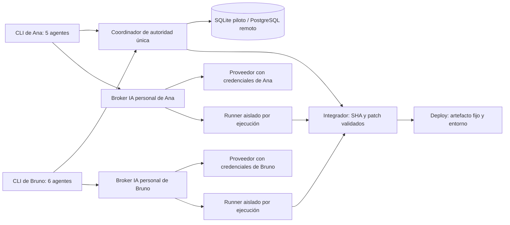
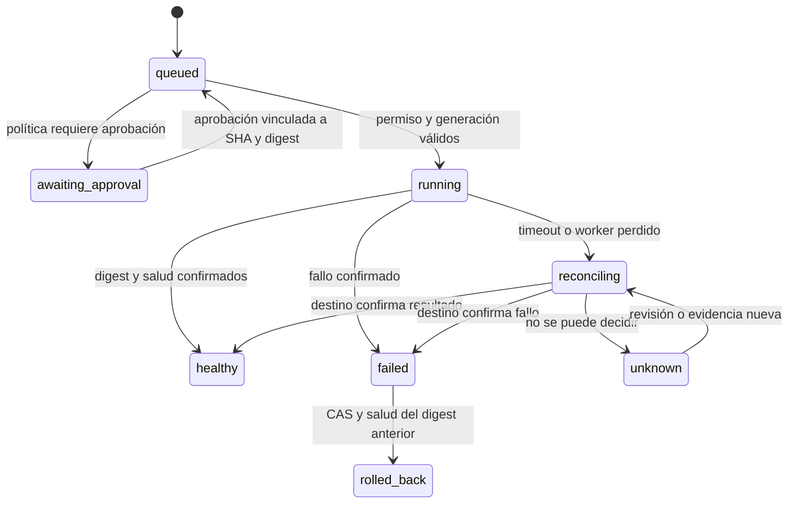

# CLIShare — superplan de producto, arquitectura e implementación

> **For agentic workers:** REQUIRED SUB-SKILL: Use superpowers:subagent-driven-development (recommended) or superpowers:executing-plans to implement this plan task-by-task. Steps use checkbox (`- [ ]`) syntax for tracking. Las autorizaciones y preferencias del usuario prevalecen sobre el procedimiento del skill.

**Goal:** Construir una CLI de IA con credenciales personales y proyectos compartidos que coordine once agentes, evolucione hacia escrituras aisladas y permita desplegar artefactos verificables sin carreras.

**Architecture:** Empezar con una CLI Python y un coordinador HTTP de loopback con SQLite WAL, transacciones, memoria CAS y leases con fences. Mantener el protocolo `/v1` independiente de la persistencia para migrar a HTTPS/PostgreSQL. Incorporar runner aislado, cola de integración y despliegue en hitos separados con garantías verificables.

**Tech Stack:** Python >=3.11, biblioteca estándar, SQLite local, `unittest`, `urllib`, `http.server`, `subprocess` sin shell. PostgreSQL y servicio HTTPS en la fase remota; Git y GitHub Actions para integración y entrega.

**Spec:** [../specs/2026-10-14-clishare-design.md](../specs/2026-10-14-clishare-design.md). Contrato HTTP: [../../PROTOCOL.md](../../PROTOCOL.md).

## Global Constraints

- Python >=3.11.
- Cero dependencias runtime de terceros en el piloto.
- SQLite con WAL para persistencia local; el archivo de base de datos permanece en disco local.
- HTTP del piloto limitado a loopback; todas las rutas de proyecto requieren bearer.
- Cuerpo HTTP máximo de 1 MiB.
- TTL de reservas por defecto de 120 segundos, rango de 1 a 3600 segundos.
- TTL de invitaciones por defecto de 3600 segundos, rango de 1 a 604800 segundos.
- Solo el propietario puede emitir invitaciones o adquirir reservas `deploy:entorno`.
- Las credenciales de IA pertenecen a cada usuario y nunca forman parte de la memoria compartida.
- No se habilitará OAuth propio de un proveedor sin un mecanismo oficial y elegibilidad comprobada.
- Las garantías sobre archivos y despliegues solo se anunciarán cuando el runner y la integración correspondiente las hagan cumplir.

---

## Cómo ejecutar y revisar el plan

La prioridad actual del usuario es **definir un superplan completo**. Las tareas 1–5 describen el primer corte local cuya base ya se ha empezado; su estado real se acredita en [ESTADO.md](../../ESTADO.md), única referencia del corte implementado y sus verificaciones. Las tareas 6–11 son evolución del producto y permanecen pendientes hasta implementar y pasar sus pruebas. Cada tarea produce un entregable utilizable; no es necesario desplegar la plataforma completa para validar el piloto. Este plan no autoriza por sí mismo costes de infraestructura, altas de servicios o despliegues de producción.

Las casillas representan pasos de trabajo, no una promesa de que ya se han realizado. La verificación final debe registrar qué tests se ejecutaron, en qué versión de Python y qué funcionalidades siguen pendientes. Los cambios de modelo/proveedor y las pruebas con credenciales reales se revisan fuera de CI para evitar gasto y exposición accidental.

Trabajar desde el directorio del repositorio. Para ejecutar desde fuentes sin instalación:

```powershell
python scripts/clishare.py --help
$env:PYTHONPATH = 'src'
python -m unittest discover -s tests -v
```

`pyproject.toml` proporciona también el comando `clishare` cuando se instala el paquete. El piloto no necesita Docker, una base remota ni un proveedor de IA para probar la coordinación.

## Visión de producto, usuarios y no objetivos

CLIShare será el punto de entrada para un equipo que quiere programar con sus propias cuentas de IA sin duplicar trabajo ni pisar cambios. El propietario controla el proyecto, invita personas, fija políticas y decide cómo integrar y desplegar. Cada miembro decide qué proveedor y credenciales utiliza, conoce el coste de sus tareas y ve qué están haciendo los demás agentes.

La unidad de colaboración será el **proyecto**, ligado a un repositorio Git y a una política versionada. La unidad de ejecución será la **tarea**, con agente, base SHA, recursos, presupuesto y resultado. La unidad de integración será un **patch/commit probado**; la de despliegue será un **artefacto inmutable**. No se mezclan esas unidades en un texto de memoria.

El producto inicial se orienta a un equipo pequeño de dos a diez personas con proyectos privados y decenas, no miles, de agentes. Se valida primero el caso concreto de dos personas con once agentes. Un usuario individual también puede utilizarlo: el modelo de coordinación es el mismo.

No son objetivos del primer producto: compartir una suscripción entre personas, crear un modelo propio, reemplazar Git, ofrecer un marketplace de agentes, intermediar credenciales no autorizadas, ejecutar código hostil en el ordenador personal ni prometer despliegue universal a cualquier nube. La primera integración real de despliegue tendrá un destino y un rollback concretos. La interfaz gráfica queda fuera del camino crítico; la CLI debe ser suficiente para colaborar.

El éxito se mide con resultados observables:

- Dos personas completan alta, invitación, asociación del repo y primera tarea sin editar configuración manualmente.
- Once agentes producen cambios trazables; no hay sobrescrituras silenciosas y todos los conflictos quedan registrados.
- Ningún proceso obsoleto puede aplicar un patch o modificar un entorno mediante un worker soportado.
- El usuario puede identificar responsable, SHA, pruebas, coste conocido o desconocido y estado de cada tarea.
- Un despliegue fallido permite recuperar la versión anterior con un procedimiento ensayado.

## Prioridades, tamaño y orden de inversión

`P0` bloquea la primera colaboración fiable; `P1` habilita trabajo útil de equipo y entrega; `P2` mejora comodidad, escala o cobertura de proveedores. El tamaño es relativo: `S` representa una unidad pequeña con una interfaz principal, `M` varias operaciones de un componente, `L` integración entre componentes y `XL` un subsistema con fallos distribuidos. No son fechas prometidas. Un spike mide primero las incertidumbres altas antes de convertirlo en estimación de calendario.

| Paquete | Prioridad | Tamaño relativo | Dependencia | Incertidumbre principal |
| --- | --- | --- | --- | --- |
| Protocolo, identidades locales y roles | P0 | M | Ninguna | Ergonomía de bootstrap y recuperación de token |
| Memoria CAS y reservas con fences | P0 | L | Identidad | Semántica de prefijos y carreras en producción |
| CLI, errores y documentación | P0 | M | Protocolo | Compatibilidad de terminales Windows |
| API keys y wrappers de texto | P0 | M | CLI | Cambios de flags y capacidades de las CLIs oficiales |
| Worktrees y runner con enforcement | P0 | XL | Reservas | Sandbox, comandos arbitrarios, filesystem y plataformas |
| HTTPS, PostgreSQL y sesiones revocables | P0 para dos máquinas | XL | Protocolo estable | Identidad, operación y recuperación |
| DAG y cola de integración | P1 | L | Runner y repositorio asociado | Compatibilidad semántica entre patches |
| Primer deploy staging y rollback | P1 | XL | Integración y destino concreto | Idempotencia del destino y fencing externo |
| Límites de agentes y gasto básico | P0 al ejecutar agentes de pago | M | Runner/providers | Uso incompleto o precio no publicado |
| OAuth propio elegible | P2 | L | Registro del proveedor | Elegibilidad y condiciones de acceso |
| Más destinos, visualización y métricas avanzadas | P2 | L por integración | Producto anterior estable | Demanda real y mantenimiento |

Orden recomendado después de cerrar el plan: verificar el piloto; hacer un spike de sandbox y otro de PostgreSQL/carreras; entregar runner aislado con presupuesto básico; habilitar dos máquinas; añadir tareas/merge; conectar staging; habilitar producción con política; ampliar login propio únicamente donde sea elegible. Presupuestos mínimos se incorporan al arrancar tareas de pago, aunque la analítica completa esté en la tarea 11.

## Distribución y única fuente de verdad

| Proceso | Dónde vive | Qué decide | Qué persiste |
| --- | --- | --- | --- |
| `clishare` CLI | Equipo de cada persona | Intención, proveedor y presentación | Configuración, referencia de sesión y caché personal |
| Coordinador local/daemon | Una máquina en el piloto | Roles, CAS, leases y fences | SQLite local y eventos |
| Servicio de coordinación remoto | Infraestructura del proyecto | Las mismas decisiones para todas las máquinas | PostgreSQL, sesiones, tareas y políticas |
| Runner | Workspace aislado por ejecución | Aplicar herramientas autorizadas mientras su ejecución es válida | Worktree, logs saneados y artefactos |
| Broker de inferencia personal | Equipo del usuario o runner privado elegido por él | Llamadas al proveedor con su cuenta y canal de herramientas limitado | Referencias de cuenta y consumo; claves solo en su almacén local |
| Integrador | Workspace de integración aislado | Resultado de checks y avance condicionado de rama | SHA base/final y resultado de pruebas |
| Worker de deploy | Entorno de ejecución con credenciales mínimas | Ejecutar una solicitud aprobada concreta | Estado externo reconciliado y digest activo |

El **store transaccional del coordinador es la autoridad** para propiedad de recursos y estados. La memoria comparte explicaciones y decisiones humanas; no es una tabla de locks. El cliente no decide que un lock ha caducado por su reloj, no borra una entrada de memoria para liberar un recurso y no sustituye la respuesta del coordinador por lo que diga otro agente. Git demuestra contenido y commits, no concede un lease.

Todos los participantes de un proyecto usan el mismo coordinador y `project_id`. El futuro comando de asociación comprueba la identidad del repositorio remoto y registra una base; crear dos proyectos llamados igual no crea coordinación entre ellos. No hay dos SQLite locales actuando como autoridad para el mismo proyecto remoto. La configuración muestra explícitamente proyecto, coordinador y repo asociados antes de iniciar un runner.

El piloto usa `clishare serve` como proceso en primer plano para facilitar inspección y cierre. Después se añadirá un daemon opcional con `start/status/stop`, sin autoiniciar un segundo coordinador cuando uno esté caído. El servicio remoto se despliega como proceso HTTP detrás de TLS; runners e integradores se escalan de forma independiente del proceso que decide los leases.



El broker evita enviar API keys al coordinador o al sandbox que ejecuta código del repositorio. Llama al proveedor desde el equipo del usuario y envía al runner herramientas mediante un token limitado a proyecto, ejecución y capacidades. El runner devuelve resultados saneados; los tests/scripts no heredan claves. Un runner privado bajo control del usuario puede alojar su broker si él lo elige. Un vault remoto sería una modalidad futura explícita con aislamiento, revocación y retención propia, nunca el comportamiento por defecto.

Una CLI oficial que no permita mediar herramientas remotas con garantías permanece como chat de texto. Ejecutar Codex en read-only no equivale a disponer ya de un agente editor remoto coordinado. La modalidad de API con herramientas mediadas puede avanzar antes que la de una CLI con suscripción.

## Repositorio asociado y permisos SCM

Inicialmente cada proyecto tiene **un repositorio**, identificado por ID estable del proveedor cuando exista, URL canónica y `integration_branch`. Los forks y renombres no cambian esa identidad por deducción del nombre. El repositorio enlazado se verifica al asociar cada checkout; tareas e integración guardan siempre base SHA. El piloto aún no tiene esta asociación formal.

El flujo final será `project create --repo` para proyecto nuevo, `project attach --path` para checkout existente y `project clone --path` para obtenerlo. La CLI comprueba acceso al proveedor SCM antes de aceptar tareas; si falla, muestra que la membresía CLIShare no otorga acceso a GitHub. Un cambio de repo o rama de integración exige owner, evento y revalidación de tareas pendientes; no se retargetean patches existentes silenciosamente.

Para el servicio remoto se propone una GitHub App con instalación seleccionada por repositorio y permisos mínimos de contenido/PR/checks necesarios para cada función. En uso local podrá utilizarse la autenticación Git del usuario o un PAT mínimo en su almacén personal, sin copiarlo al coordinador como credencial general. Las credenciales SCM, las del proveedor IA y las de despliegue son tres ámbitos independientes. Ningún token de IA se usa para acceder a GitHub.

## Memoria, contexto de ejecución y reglas humanas

| Capa | Contenido | Autoridad y alcance |
| --- | --- | --- |
| Estado transaccional | Miembros, permisos, tareas, leases, presupuesto y despliegues | DB del coordinador; únicamente operaciones autorizadas lo cambian |
| Conocimiento compartido | Decisiones, contratos, evidencias y handoffs | Memoria versionada del proyecto, con autor y procedencia |
| Sesión privada | Conversación personal, borradores y detalles de una ejecución | Privada por usuario/run; no se publica automáticamente |

No se publicará razonamiento interno del modelo, secretos ni conversaciones completas como memoria automática. Una promoción de conocimiento contiene un resumen útil con evidencia y alcance. Las reglas del propietario en `AGENTS.md`/política humana se cargan con prioridad explícita; el contenido recuperado se etiqueta como dato. La corrección humana versionada prevalece sobre resúmenes de agente. Una entrada de memoria no puede modificar permisos, límites de gasto ni autorizar herramientas o deploys.

La evolución de las entradas añade `kind` (`decision`, `contract`, `evidence`, `handoff`), `scope` (proyecto/tarea/recurso), `status` (`proposed`, `verified`, `superseded`), `author`, `source_commit`, referencias `evidence`, `version` y `expires_at` opcional. Se conservan revisiones y relaciones de sustitución. `verified` requiere comprobación humana o evidencia registrada según tipo; no basta que el agente escriba esa palabra. Los campos nuevos no se presuponen presentes en la memoria simple del piloto.

El futuro `ContextAssembler` aplica ACL **antes** de recuperar o indexar contenido, selecciona reglas/contratos pertinentes y genera un manifiesto por ejecución: claves y versiones utilizadas, origen/commit, base SHA, revisión de políticas, presupuesto de contexto y documentos excluidos. Al iniciar una tarea nueva o cambiar base se refresca; durante una tarea solo se incorporan novedades relevantes con su versión. La sincronización incremental usa revisión/event cursor persistente; un cursor perdido fuerza una lectura autorizada completa.

El contexto tiene límites por bytes y por tokens cuando exista medición fiable. Si no cabe, conserva reglas y contratos críticos, resume evidencias y marca omisiones; no corta arbitrariamente instrucciones o JSON. Se empieza con claves, scopes y búsqueda de texto. Embeddings solo se incorporan si una evaluación con casos reales mejora recuperación/coste y mantiene ACL, borrado y procedencia.

## UX de terminal del producto final — propuesta, aún sin implementar

Los comandos de esta sección definen el flujo deseado. **No son la ayuda del piloto actual**; sus comandos existentes están detallados en tareas 4 y 5. Antes de implementar cada familia se fijarán formato JSON, exit codes y contrato en el protocolo. La CLI ofrece salida humana por defecto y `--json` para automatización; `--no-input` evita prompts interactivos en CI.

| Momento | Comando propuesto | Resultado visible |
| --- | --- | --- |
| Entrar en CLIShare remoto | `clishare login --server https://equipo.example` | Cuenta y servidor; credencial guardada localmente |
| Crear proyecto | `clishare project create acme --repo https://github.com/equipo/acme.git` | ID de proyecto, owner y repo |
| Invitar | `clishare project invite acme --role member --ttl 86400` | Token de un uso, expiración y rol; envío fuera de la CLI |
| Aceptar | `clishare project join --invite-stdin` | Membresía, permisos y coordinador |
| Asociar checkout | `clishare project attach acme --path .` | Repo verificado, rama y SHA de referencia |
| Elegir IA | `clishare provider login codex` o API key de entorno | Modalidad personal y capacidades disponibles |
| Definir política | `clishare policy set acme --max-agents 11 --daily-budget 20 --currency EUR` | Política propuesta/guardada por owner; 20 es un ejemplo elegido, no un precio |
| Crear tarea | `clishare task add acme "Endpoint de perfil" --resource file:src/profile --resource file:tests/profile` | ID, recursos, dependencias y estado queued |
| Ejecutar cinco agentes | `clishare agent start acme --count 5 --provider codex` | Ejecuciones, workspaces, cola y presupuesto reservado |
| Ejecutar seis agentes | `clishare agent start acme --count 6 --provider anthropic --model MODELO` | Seis ejecuciones bajo la identidad del segundo usuario |
| Ver equipo | `clishare status acme --watch` | Agentes, propietarios, tareas, conflictos y gasto conocido |
| Contexto | `clishare memory list acme` | Página y versiones; contenido sin secretos |
| Recuperar fallo | `clishare task resume acme task-42` | Nueva ejecución/fence y artefactos previos disponibles |
| Revisar cambio | `clishare task diff acme task-42` | Diff, SHA base, autor y checks |
| Integrar | `clishare merge enqueue acme task-42` | Posición y resultado de cola por proyecto |
| Promover staging | `clishare deploy request acme staging --sha SHA --artifact sha256:DIGEST --idempotency-key release-7` | Solicitud y artefacto fijo |
| Aprobar producción | `clishare deploy approve acme deploy-7` | Actor y política de aprobación |
| Recuperar entorno | `clishare deploy rollback acme production --to sha256:DIGEST_ANTERIOR` | Solicitud de rollback auditable |
| Auditar | `clishare audit acme --task task-42 --json` | Eventos y referencias, sin claves ni prompts por defecto |

`MODELO`, `SHA` y `DIGEST` son argumentos que el usuario selecciona o que produce una operación previa, no valores de configuración pendientes del diseño. Se mantiene selección explícita de modelo para APIs; no se fija un nombre que pueda quedar obsoleto. Los importes de una política son límites elegidos por el propietario, no estimaciones de tarifas del proveedor.

Los errores de recursos muestran qué ámbito está ocupado, por qué ejecución y cuándo caduca, sin exponer datos de otro proyecto. La CLI distingue `blocked_resource`, `blocked_dependency`, `budget_exceeded`, `coordinator_unavailable`, `provider_auth_failed` y `review_required`. Una tarea bloqueada no se presenta como completada. Las operaciones largas imprimen estado y conservan un ID que permite reanudar consulta después de cerrar la terminal.

## Recorrido completo de dos personas con 5 + 6 agentes

1. Ana crea `acme`, asocia el repo privado y fija límites de miembros, agentes y producción. Si Bruno no tiene acceso al repo de GitHub, el sistema muestra ese requisito independiente de su membresía CLIShare.
2. Ana genera invitación member de un uso. Bruno inicia sesión con su identidad, la consume y asocia su checkout del mismo repo. Ambos ven proyecto, políticas y coordinador idénticos; cada uno conserva credenciales IA propias.
3. Guardan decisiones en `architecture` y `acceptance/profile`, con versiones. Crean once tareas pequeñas: API, UI, tests, documentación y refactor independiente. Dos tareas que requieren el mismo módulo quedan dependientes o compiten por su ámbito; no se promete paralelismo de todo el repositorio.
4. Ana arranca A1–A5 y Bruno B1–B6. El planificador comprueba identidad, presupuesto y slots. Asigna solo tareas listas y crea worktree desde SHA registrado para cada ejecución.
5. A1 adquiere `file:src/profile`; B1 necesita `file:src/profile/routes.py`. El coordinador concede una petición y bloquea la otra. B1 puede recibir otra tarea lista; no reduce el namespace a escondidas para eludir la reserva.
6. A2 y B2 trabajan en ámbitos distintos. Antes de cada escritura el runner valida contexto/lease; heartbeat renueva. Los cambios se quedan en worktrees propios. Una decisión nueva usa CAS; conflicto de versión obliga a reconciliar contenido.
7. B3 pierde conexión. Su runner cierra la puerta de herramientas de escritura, detiene el proceso y conserva worktree. La tarea queda interrumpida y, cuando caduca el lease, otro agente puede adquirir una generación nueva. B3 no vuelve a aplicar automáticamente su trabajo al recuperar red.
8. A1 entrega commit contra su base SHA. El sistema registra diff, recursos realmente tocados, checks y coste. Si tocó rutas fuera de lo reservado, rechaza el resultado o exige adquirir esos ámbitos y revalidar; no amplía permisos retroactivamente.
9. Ana o la política encola integración. El integrador aplica cada patch sobre la base final, vuelve a ejecutar checks y avanza la rama con comparación de SHA. Los cambios incompatibles vuelven a review; una reserva de archivo distinta no demuestra compatibilidad semántica.
10. Una vez integradas las tareas, se construye el artefacto para un SHA concreto. Ana solicita staging con digest e idempotency key. Dos workers compitiendo dejan un único intento activo; una respuesta de red perdida se reconcilia por ID externo.
11. La prueba de salud confirma staging. Producción sigue la política de aprobación del proyecto; un member no promueve. Si falla salud, se registra `failed` y se despliega el digest anterior con el mismo control de entorno. Ambos ven qué versión quedó activa.
12. Se libera presupuesto no consumido y se archivan artefactos según retención. La auditoría permite reconstruir quién produjo, revisó, integró y desplegó cada cambio. Las credenciales IA no aparecen en ese rastro.

## Conectividad, fallos y autoridad de escritura

| Estado | Operaciones permitidas | Operaciones suspendidas | Recuperación |
| --- | --- | --- | --- |
| Coordinador disponible | Leer, CAS, adquirir/renovar y ejecutar según permisos | Las rechazadas por política | Flujo normal |
| Solo caché local | Consultar contexto con indicador de antigüedad; planificar; chat personal sin herramientas | Adquirir/renovar, writes del runner, merge y deploy | Releer estado al recuperar red |
| Renovación falla | Conservar archivos/artefactos y consultar estado | Nuevas herramientas de escritura y publicación de resultados | Revalidar con lease nuevo y base SHA |
| Proveedor IA cae | Leer estado y conservar ejecución | Nueva generación del proveedor afectado | Backoff limitado; fallback solo si política permite destino/coste |
| Integrador cae | Encolar y ver estado persistido | Avanzar rama sin reconciliar intento | Comprobar SHA actual antes de reanudar |
| Worker de deploy cae | Consultar solicitud/estado del destino | Ejecutar otro intento a ciegas | Reconciliar operación externa e idempotencia |

No existe un modo de escritura offline contra el proyecto compartido en la primera versión con garantías. Se puede redactar una propuesta fuera del runner, pero su importación será un patch nuevo que debe adquirir recursos, comparar base y pasar checks. El cliente no extiende un TTL por estar desconectado. El reloj que determina expiración es el del coordinador; las cuentas atrás del terminal son orientativas.

Una comprobación HTTP seguida de una escritura libre no elimina una carrera. La garantía se obtiene combinando: worktrees separados para evitar tocar el mismo checkout; herramientas limitadas al workspace; runner que deja de escribir cuando pierde autorización; y verificación transaccional/condicionada en el punto donde el integrador o el desplegador publica el resultado. Si un proveedor de despliegue no permite compare-and-set ni comprobar fence, CLIShare debe serializar mediante un único adaptador propietario y reconciliar antes de permitir reemplazo.

La prueba de aceptación obligatoria pausa un agente **después de validar**, deja vencer su lease, concede una generación nueva a otro agente y después reanuda el primero. El primero puede conservar artefactos, pero jamás puede integrar ni desplegar. La decisión `accept_patch` se serializa con la transición del lease/ejecución y la comparación de base; no basta que un runner haya consultado un endpoint segundos antes.

## Revocación y límites mínimos antes de ejecutar agentes

La identidad remota tendrá `authorization_generation` por usuario/agente y las ejecuciones guardarán la generación autorizada. Revocar miembro, sesión, agente o cambiar política incrementa la generación/invalida capacidades. El servicio vuelve a comprobar permisos al reclamar tarea, autorizar herramientas, pasar a review, integrar y ejecutar/aprobar/recuperar deploy. El trabajo ya encolado no conserva indefinidamente permisos antiguos. Los artefactos se conservan según retención, pero un usuario revocado no puede seguir leyéndolos por un token de descarga sin caducidad.

Antes del primer runner con consumo se implementan límites P0. Propuesta inicial configurable: máximo 11 ejecuciones activas por proyecto, 15 minutos por intento, 20 llamadas de inferencia por intento y 1 MiB capturado por stream de cada comando. El contexto/modelo se limita además por las capacidades verificadas del adaptador. Un presupuesto monetario complementa estos límites y no los reemplaza; una llamada lenta o una salida infinita sigue teniendo límites aunque el precio sea desconocido.

La autorización de consumo crea una reserva idempotente ligada a `run_id`/intento y período. Reintentar la misma operación no duplica reserva ni liquidación. Un crash deja la reserva recuperable: se reconcilia uso confirmado, se libera saldo sobrante y se marca como desconocida la parte no medible. No se convierte consumo desconocido en cero. Para precio no conocido, la política debe permitir expresamente esa modalidad y conservar límites finitos de solicitudes/tiempo/salida; se muestra `coste desconocido` antes de iniciar.

Las capacidades se registran por **proveedor, modalidad, modelo y versión**: autenticación `verified/unknown`, texto, herramientas mediables, sandbox, streaming, límite de contexto/salida y disponibilidad de uso/precio. `configured=true` significa que existe configuración, no que el login, crédito o modelo estén verificados. Un dato desconocido permanece desconocido y no se transforma en `false` o una tarifa inventada. El runner solo habilita las herramientas cuya capacidad haya comprobado.

## Sandbox y plataformas: alcance de la garantía

La CLI y el protocolo se soportan en Windows, Linux y macOS. El primer runner con ejecución arbitraria y garantía de aislamiento se propone **gestionado en Linux**, en contenedores o VMs con controles comprobados. Un usuario Windows puede controlarlo desde su terminal. Un runner nativo de Windows/macOS no se publicará como equivalente hasta verificar sus controles específicos; mientras tanto admite lectura/chat y utilidades de worktree, con límites indicados.

El sandbox recibe únicamente el checkout de la tarea con escritura, una raíz temporal y las herramientas necesarias. El filesystem del host y el checkout de integración no están montados; no recibe socket Docker, SSH agent ni credenciales de producción. La red está deshabilitada por defecto; los accesos al proveedor pasan por un canal con política y secreto mínimo. Se deshabilitan privilegios, se limitan CPU/memoria/procesos y se valida que un subprocess no escape mediante symlink, junction, procfs o un mount inesperado.

El worktree evita colisiones de contenido, pero no es sandbox por sí mismo: comparte objetos Git y un proceso con permisos del usuario puede acceder a otros directorios. Para ejecución arbitraria se materializa/exporta un checkout dentro del aislamiento y se obtiene un patch/commit como artefacto; la integración ocurre fuera, en un worker diferente. Los scripts de proyecto y tests se consideran código que puede actuar, no simples lecturas.

Antes del hito se ejecutan pruebas negativas: leer un archivo señuelo del host, escribir en un checkout vecino, abrir socket no permitido, acceder a secreto señuelo, agotar procesos y aplicar un symlink externo. El resultado debe ser denegación y evento; un simple assert de `Path.resolve()` no acredita este sandbox.

## Recuperación y split-brain en integración y deploy

El servicio remoto utiliza una base de datos de autoridad única con transacciones. Las réplicas de lectura nunca conceden leases. Se bloquea la fila del proyecto/entorno para decidir propietario y generación; no se utiliza un lock en memoria de un proceso HTTP. Una partición de red no autoriza a otro nodo a crear un contador local.

Un worker toma una solicitud persistida mediante transición condicional a `running`, registra su `worker_id`, generación e identificador de intento y renueva. Otro worker puede recuperar trabajo tras caducidad, pero primero consulta el estado externo. Un worker antiguo no puede reportar éxito para una generación nueva ni cambiar el estado de una solicitud cuyo intento ya no posee.

Las aprobaciones se vinculan al conjunto inmutable `project_id + environment + commit_sha + artifact_digest + policy_revision`. Cambiar cualquiera de esos datos invalida la aprobación. Además de `queued/running/healthy/failed/rolled_back`, el despliegue tendrá `awaiting_approval`, `reconciling` y `unknown`; el sistema no presenta un estado ambiguo como fallo seguro que permita volver a ejecutar a ciegas.

La API del destino ideal admite idempotency key y comparación de versión. Si no, el adaptador mantiene un único punto de escritura por entorno, consulta estado antes de recuperar y detiene promociones cuando existe un intento ambiguo. No se afirmará exactamente una ejecución física si la API externa no lo permite; sí se conservará una única intención lógica, su reconciliación y un estado explícito que requiere revisión cuando no pueda decidirse.

El rollback no cancela la historia: crea una solicitud con digest anterior, actor y causa. Puede fallar y necesita su propia prueba de salud. El sistema evita marcar `rolled_back` hasta confirmar qué versión sirve el destino. Las credenciales de staging no autorizan producción y los agentes que generan código no reciben credenciales de despliegue.

Un rollback tardío de A no puede deshacer un despliegue B que ya quedó healthy. Cada modificación del entorno compara `active_deployment_id`, `expected_digest` y generación de entorno. Si ya cambió, A queda obsoleto y requiere una nueva intención aprobada; no ejecuta una restauración basada en el estado que recordaba antes del fallo.



## Migración de SQLite a PostgreSQL sin dos autoridades

1. Estabilizar el contrato `/v1` y ejecutar los mismos tests de permisos, CAS, prefijos, TTL y fences sobre ambos stores.
2. Crear migraciones con versión de esquema, constraints e índices. En PostgreSQL la adquisición bloquea la fila de proyecto para cubrir prefijos; validar rendimiento antes de intentar una granularidad más compleja.
3. Preparar importador que conserve IDs, membresías, versiones de memoria y auditoría. Ajustar la secuencia de fences por encima del máximo importado. Los tokens pueden requerir reinicio de sesión según el modelo remoto; ese cambio se anuncia antes de migrar.
4. Poner el proyecto local en modo mantenimiento: no aceptar nuevas escrituras ni adquisiciones; detener runners y esperar/liberar leases. Exportar backup consistente mediante API de backup SQLite, no copiar solo `.sqlite3` ignorando WAL.
5. Importar en una transacción, comparar conteos/checksums y ejecutar pruebas de lectura/autorización. Invalidar leases previos; las ejecuciones reanudadas adquieren generaciones nuevas y vuelven a validar base.
6. Cambiar la URL de coordinación una vez; el antiguo coordinador queda en lectura o cerrado. No hacer dual-write de locks. Documentar timestamp y autoridad nueva.
7. Probar alta/invitación, CAS y carrera de once clientes desde dos máquinas. Conservar backup cifrado y registro de migración según retención.
8. Si la comprobación falla antes del corte, volver al backup local. Si PostgreSQL ya recibió cambios, no reabrir SQLite antiguo como autoridad: exportar/reconciliar esos cambios mediante un procedimiento revisado y un nuevo corte de mantenimiento.

## Definición de terminado por entrega y compatibilidad

Una tarea termina cuando su comportamiento pasa pruebas positivas y negativas, su interfaz y permisos están documentados, no incorpora secretos y sus limitaciones son visibles. Un hito remoto también necesita despliegue reproducible, backup/restauración, observabilidad y procedimiento de recuperación; un hito de proveedor necesita capacidades y condiciones verificadas con documentación oficial.

Las primeras versiones son alpha `0.x`. El protocolo tiene versión propia: conservar `/v1` exige adiciones compatibles; un cambio incompatible recibe una versión nueva y un período de convivencia. Cada cliente envía su versión/capacidades; el servidor puede rechazar una versión que no comprende fences o políticas requeridas. Las migraciones guardan versión de esquema y se ensayan con datos del release anterior.

La matriz de release incluye Python mínimo declarado y sistemas Windows/Linux/macOS para CLI. Las capacidades del runner se publican por plataforma; no se infieren de que la ayuda funcione. Se fijan versiones probadas de CLIs oficiales y se consultan sus flags al ejecutar. Un cambio upstream sin modo seguro causa rechazo explícito, no pérdida silenciosa de controles. Releases incluyen changelog, checksums y procedimiento de actualización y reversión; no se actualiza un runner en medio de un intento activo.

## Decisiones abiertas con propuesta de partida

Estas decisiones no bloquean la redacción ni el piloto. Se resuelven al abrir el hito correspondiente; la propuesta permite comparar coste y alcance sin inventar una preferencia del usuario.

| Decisión | Propuesta de partida | Momento de cierre | Evidencia para decidir |
| --- | --- | --- | --- |
| Alojamiento del coordinador | Servicio autohospedado por proyecto/equipo, PostgreSQL gestionado si encaja | Antes del hito remoto | Coste mensual real, backups y requisitos de acceso |
| Identidad CLIShare remota | Login propio mediante proveedor OIDC autorizado; cuenta de IA separada | Diseño del hito remoto | Facilidad de alta, revocación y disponibilidad |
| Runner estricto inicial | Linux gestionado; CLI en tres plataformas | Spike de sandbox | Pruebas de escape y coste/latencia |
| Acceso Git | Credencial mínima por repo y usuario/servicio; sin token general de cuenta | Hito de integración | Permisos necesarios y revocación |
| Primer destino deploy | Un staging con API idempotente y artefactos por digest | Antes de tarea 9 | Entorno real del proyecto y rollback verificable |
| Aprobación producción | Owner aprueba; automatización solo por política explícita | Antes del primer deploy producción | Riesgo del destino y capacidad de rollback |
| Quién paga IA | Cada persona paga su proveedor; límites del proyecto coordinan consumo | Antes de tareas de pago | Modalidad de cuentas y política del equipo |
| Distribución pública y licencia | Publicar CLIShare bajo MIT de OSI, elegido por el propietario | Preparación open source | Repositorio público, licencia y guía reproducible |
| Retención de prompts/artefactos | No guardar prompts en auditoría por defecto; artefactos con política explícita | Antes de servicio remoto | Necesidad de depuración, datos sensibles y almacenamiento |
| OAuth propio | Solo cuando el cliente cumpla requisitos oficiales | Tarea 10 | Registro aprobado y capacidades documentadas |

No se fijan tarifas de proveedores en este plan: cambian y dependen de modalidad, modelo y unidad. El presupuesto de producto tendrá precios con fuente y fecha, costes reales cuando existan y estado desconocido cuando no puedan calcularse.

## Mapa de archivos y dependencias

| Archivo | Responsabilidad | Estado del hito |
| --- | --- | --- |
| `pyproject.toml` | Paquete, Python mínimo y entrypoint | Piloto |
| `scripts/clishare.py` | Ejecutar desde fuente sin instalar | Piloto |
| `src/clishare/__init__.py`, `__main__.py` | Versión y entrada de módulo | Piloto |
| `src/clishare/errors.py` | Error de dominio con status/code/message | Piloto |
| `src/clishare/store.py` | SQLite, identidad, proyectos, invitaciones, CAS, leases, eventos | Piloto |
| `src/clishare/server.py` | HTTP, límites, autenticación, rutas y loopback | Piloto |
| `src/clishare/client.py` | Transporte HTTP y traducción de errores | Piloto |
| `src/clishare/cli.py` | Parseo y comandos | Piloto |
| `src/clishare/providers.py` | API de IA y wrappers de CLI oficial | Piloto |
| `tests/test_store.py` | Carreras, permisos, TTL y persistencia | Piloto |
| `tests/test_server.py` | Contrato HTTP real | Piloto |
| `tests/test_providers.py` | Requests y subprocess simulados | Piloto |
| `tests/test_cli.py` | Flujo CLI, credenciales y errores | Piloto |
| `.gitignore`, `.env.example`, `AGENTS.md`, `README.md` | Uso, límites, reglas visibles y secretos excluidos | Piloto |
| `docs/templates/ci.yml.example` → `.github/workflows/ci.yml` | Plantilla de CI; activación requiere permiso de publicación de workflows | Pendiente de activar |
| `src/clishare/runner.py`, `workspace.py` | Escritura mediada, worktrees y heartbeat | Hito de aislamiento |
| `src/clishare/context.py`, `broker.py` | Manifiesto de contexto y llamada IA personal sin claves en sandbox | Hito de aislamiento |
| `src/clishare/tasks.py`, `integration.py` | DAG y cola de merge | Hito de flujo |
| `src/clishare/remote/` | Persistencia PostgreSQL, identidad y despliegue HTTPS | Hito remoto |
| `src/clishare/deploy.py` | Cola, worker y rollback de artefactos | Hito de despliegue |
| `src/clishare/usage.py`, `policy.py` | Consumo y presupuestos | Hito operativo |

Orden del piloto: `errors → store → server → client/CLI`; `providers → CLI`. Orden de aislamiento e integración: **6A → 6B → 8A → 6C → 8B → 9**. La tarea 7 remota puede avanzar en paralelo cuando esté estable el contrato y debe completarse antes de ofrecer colaboración entre máquinas. 8A es el gate mínimo de aceptación, independiente del DAG/cola completa de 8B; así no existe dependencia circular con el runner. Los cambios de contratos compartidos se comunican antes de editar módulos vecinos.

## Tarea 1: Identidades y proyectos persistentes

**Archivos:** crear `src/clishare/errors.py`, `src/clishare/store.py`, `tests/test_store.py`; configurar `pyproject.toml`.

**Interfaces consumidas:** `pathlib.Path`, `sqlite3`, `secrets`, `hashlib`, `time.time`, `typing.Callable` de biblioteca estándar.

**Interfaces producidas:**

```text
DomainError(status: int, code: str, message: str)
Store(db_path: str | Path, clock: Callable[[], float] = time.time)
Store.register_user(name: str) -> dict
Store.authenticate(token: str) -> str
Store.create_project(user_id: str, name: str) -> dict
Store.list_projects(user_id: str) -> list[dict]
```

- [ ] Añadir pruebas de persistencia, nombre duplicado por `casefold()`, autenticación inválida, nombres vacíos/control y proyecto privado. Ejecutar la prueba y comprobar que falla por ausencia de implementación:

```powershell
$env:PYTHONPATH = 'src'
python -m unittest tests.test_store.StoreTests.test_identity_is_persistent_unique_and_authenticates_hashed_tokens -v
```

- [ ] Crear tablas e índices con claves foráneas activas, `journal_mode=WAL` y timeout SQLite finito. Emitir un secreto aleatorio y almacenar su digest, nunca el secreto. La operación esencial es:

```python
token = secrets.token_urlsafe(32)
token_hash = hashlib.sha256(token.encode('utf-8')).hexdigest()
```

- [ ] Validar `name` antes de la transacción: usuario de 1–80 caracteres, proyecto de 1–120, sin controles y sin texto solo de espacios. Crear proyecto y membresía owner en una transacción. Convertir duplicado en `409 name_taken` y token inválido en `401 invalid_token`.

- [ ] Ejecutar pruebas de identidad, listado y permisos. Inspeccionar el dump de la BD con esta aserción dentro de `test_store.py`:

```python
with sqlite3.connect(self.path) as connection:
    dump = '\n'.join(connection.iterdump())
self.assertNotIn(self.owner['token'], dump)
self.assertIn(hashlib.sha256(self.owner['token'].encode()).hexdigest(), dump)
```

**Aceptación:** reiniciar `Store` conserva identidad y proyectos; el listado nunca incluye el proyecto de un no miembro; los tokens no aparecen en SQL. Revisar y guardar un commit cohesivo tras pasar las pruebas.

## Tarea 2: Roles, invitaciones y memoria CAS

**Archivos:** modificar `src/clishare/store.py`; ampliar `tests/test_store.py`.

**Interfaces consumidas:** `Store.authenticate`, tablas de usuarios/proyectos/membresías y `DomainError` de tarea 1.

**Interfaces producidas:**

```text
Store.create_invite(user_id: str, project_id: str, role: str = 'member', ttl: int = 3600) -> dict
Store.accept_invite(user_id: str, token: str) -> dict
Store.list_memory(user_id: str, project_id: str) -> list[dict]
Store.list_memory_page(user_id: str, project_id: str, limit: int = 10, after: str | None = None) -> dict
Store.put_memory(user_id: str, project_id: str, key: str, content: str, expected_version: int) -> dict
Store.list_events(user_id: str, project_id: str, limit: int = 100) -> list[dict]
```

- [ ] Añadir tests de viewer, outsider, invitación de un uso/expirada, preservación de owner y CAS. Crear once usuarios que intentan consumir el mismo token usando `Barrier(11)` y `ThreadPoolExecutor(max_workers=11)`. Afirmar un éxito y diez `409`.

- [ ] Ejecutar los casos antes de implementar:

```powershell
python -m unittest tests.test_store.StoreTests.test_concurrent_invitation_acceptance_has_exactly_one_winner tests.test_store.StoreTests.test_concurrent_memory_cas_prevents_lost_updates -v
```

- [ ] Implementar autorización en cada operación. En una transacción inmediata, comprobar token de invitación, `used_by` y `expires_at`, añadir membresía y marcar uso. Usar TTL entero estricto dentro de 1–604800; rechazar `owner` como rol de invitación. El criterio de consumo es:

```python
expired = now >= invite['expires_at']
consumed = invite['used_by'] is not None
```

- [ ] En memoria, comparar la versión almacenada con `expected_version` dentro de la misma transacción que escribe y registra `memory.updated`. Ausencia de clave equivale a versión 0. La nueva versión es `current_version + 1`; un desfase produce `409 version_conflict` y no escribe. Añadir `list_memory_page` con `limit=1..10`, `after` exclusivo, orden de clave y `limit+1` filas para calcular `next_cursor`; conservar `list_memory` para tests de dominio y uso interno.

- [ ] Ejecutar tests de permisos, invitaciones, CAS y eventos. Añadir aserción de ausencia de secretos/contenido en auditoría:

```python
serialized = json.dumps(self.store.list_events(self.viewer['id'], self.project['id']))
self.assertNotIn(self.owner['token'], serialized)
self.assertNotIn('PRIVATE-CONTENT', serialized)
```

**Aceptación:** once escrituras con versión inicial 0 dejan una sola entrada en versión 1; viewer solo lee; invitación desconocida/caducada/usada responde de forma explícita. Revisar y guardar un commit tras pasar las pruebas.

## Tarea 3: Reservas transaccionales y fences

**Archivos:** modificar `src/clishare/store.py`; ampliar `tests/test_store.py`.

**Interfaces consumidas:** autorización y eventos de tareas 1–2; reloj inyectable para pruebas de caducidad.

**Interfaces producidas:**

```text
Store.acquire_leases(user_id: str, project_id: str, agent_id: str, resources: list[str], ttl: int = 120) -> list[dict]
Store.list_leases(user_id: str, project_id: str) -> list[dict]
Store.renew_lease(user_id: str, project_id: str, lease_id: str, fence: int, ttl: int = 120) -> dict
Store.release_lease(user_id: str, project_id: str, lease_id: str, fence: int) -> dict
```

- [ ] Escribir tests de once agentes distribuidos cinco/seis entre owner/member, prefijos, casefold, lote atómico, TTL, fence tras reinicio y propiedad de lease. Ejecutar:

```powershell
python -m unittest tests.test_store.StoreTests.test_eleven_agents_across_two_users_have_one_lease_winner tests.test_store.StoreTests.test_batch_acquisition_is_atomic_when_any_resource_conflicts -v
```

- [ ] Implementar recursos canónicos. Rechazar rutas no relativas, `\`, `.`, `..`, doble `/`, sufijos ambiguos, nombres Windows reservados y recursos duplicados/solapados en un lote. Para dos rutas ya validadas, el conflicto de prefijo se decide con límites de segmento:

```python
conflict = left == right or left.startswith(right + '/') or right.startswith(left + '/')
```

- [ ] Dentro de una transacción inmediata, leer reservas activas del proyecto (`expires_at > now`), comprobar todos los recursos, incrementar la secuencia persistente e insertar una fila por recurso. Si hay conflicto, deshacer el lote completo. Reservar `deploy:*` exige owner y compara entornos normalizados exactos.

- [ ] Implementar renovación/liberación comprobando proyecto, propietario, `expires_at > now` y fence exacto. Validar entero positivo del fence y TTL entero de 1–3600. Renovación conserva fence; nueva adquisición recibe uno mayor. No borrar la secuencia al liberar ni al caducar.

- [ ] Ejecutar todos los tests de store y verificar el resultado de la carrera:

```python
self.assertEqual(sum(status == 'ok' for status, _ in results), 1)
self.assertEqual(sum(status == 409 for status, _ in results), 10)
self.assertEqual(len(self.store.list_leases(self.owner['id'], self.project['id'])), 1)
```

**Aceptación:** no hay dos leases activos de recursos solapados; expiración libera disponibilidad; un holder antiguo no renueva ni libera una reserva nueva; no miembro y viewer no mutan. Las pruebas no afirman bloqueo del filesystem. Revisar y guardar un commit tras pasar los tests.

## Tarea 4: Servidor HTTP y CLI usable

**Archivos:** crear `src/clishare/server.py`, `client.py`, `cli.py`, `__main__.py`, `scripts/clishare.py`, `tests/test_server.py`, `tests/test_cli.py`; documentar `docs/PROTOCOL.md` y `README.md`.

**Interfaces consumidas:** métodos de `Store` de tareas 1–3 y `DomainError`.

**Interfaces producidas:**

```text
make_server(db_path: str | Path, host: str = '127.0.0.1', port: int = 8765) -> Coordinator
Coordinator.serve_forever() -> None
Coordinator.shutdown() -> None
Coordinator.server_close() -> None
Client(url: str = 'http://127.0.0.1:8765', token: str | None = None)
Client.request(method: str, path: str, body: dict | None = None) -> dict | list
main(argv: list[str] | None = None) -> int
```

- [ ] Crear tests HTTP con puerto efímero `port=0`, hilo de servidor y `urllib.request`, sin red externa. Comprobar el flujo de dos identidades, autenticación, JSON inválido, rechazo de Origin/Host público y bind `0.0.0.0`.

- [ ] Ejecutar `python -m unittest tests.test_server -v` y registrar el fallo inicial. Implementar dispatch conforme a `docs/PROTOCOL.md`, status 201 para altas/proyectos/invitaciones/adquisiciones y 200 para las demás operaciones. Traducir `DomainError` al sobre `error`; no devolver traceback ni SQL.

- [ ] Validar `Content-Length` antes de leer un cuerpo mayor de 1 MiB y exigir objeto JSON. Mantener bearer fuera de logs. Limitar bind y transporte del piloto a loopback. El cliente no seguirá un redirect que pueda reenviar credenciales a otro host.

- [ ] Implementar parser de CLI con estos comandos exactos:

```text
serve --db .clishare/coordinator.sqlite3 --port 8765
auth register NAME
project create NAME
project list
project invite PROJECT --role member --ttl 3600
project join [--invite-stdin]
memory list PROJECT [--limit 10] [--after KEY]
memory put PROJECT KEY (--content TEXT | --file FILE) --expected-version N
lease acquire PROJECT AGENT RESOURCE... --ttl 120
lease list PROJECT
lease renew PROJECT LEASE_ID FENCE --ttl 120
lease release PROJECT LEASE_ID FENCE
deploy reserve PROJECT ENV --agent AGENT --ttl 120
events PROJECT
```

- [ ] Persistir configuración personal fuera del repositorio. `--url` global o `CLISHARE_URL` elige coordinador; `CLISHARE_TOKEN` proporciona bearer de coordinación. `project join` recoge el token con `getpass` o stdin, para no colocarlo en argumentos visibles del proceso. `deploy reserve` solo adquiere `deploy:ENV` y debe decirlo en su ayuda/salida.

- [ ] Ejecutar tests HTTP/CLI y hacer smoke test en dos terminales con registros de prueba. Probar once entradas de memoria de 256 KiB: la primera página debe contener diez entradas y `next_cursor`, la segunda la restante, sin truncamiento JSON. HTTP devuelve `data.items` y `data.next_cursor`; la CLI muestra esa página explícita y el cliente rechaza respuestas superiores a 32 MiB con `response_too_large`. Confirmar que no se necesita instalar paquete para `python scripts/clishare.py --help` y que los errores devuelven exit code distinto de cero.

**Aceptación:** CLI y HTTP permiten todo el flujo local sin editar la BD, y los límites publicados coinciden con el comportamiento. Revisar y guardar un commit tras pasar pruebas.

## Tarea 5: IA con credenciales personales, distribución y CI

**Archivos:** crear `src/clishare/providers.py`, `tests/test_providers.py`, `.env.example`, `.gitignore`, `.github/workflows/ci.yml`, `AGENTS.md`; ampliar `src/clishare/cli.py`, `tests/test_cli.py`, `README.md`. La primera entrega guarda el workflow en `docs/templates/ci.yml.example` hasta disponer de permiso para activarlo.

**Interfaces consumidas:** `urllib.request`, `subprocess.run`, `shutil.which`, variables de entorno y `DomainError`. Ningún adaptador recibe credenciales del coordinador.

**Interfaces producidas:**

```text
providers.chat(provider: str, model: str | None, prompt: str) -> str
providers.login(provider: str) -> int
providers.status() -> list[dict]
```

- [ ] Crear pruebas con HTTP/subprocess simulados: clave ausente, modelo ausente, payload, timeout, 401 remoto sin filtrar cuerpo, respuesta incompleta, CLI no instalada, versión sin flags y login interactivo delegado. Ejecutar `python -m unittest tests.test_providers -v` antes de implementar.

- [ ] Implementar APIs OpenAI Responses, Anthropic Messages y Google generateContent mediante HTTPS. Leer `OPENAI_API_KEY`, `ANTHROPIC_API_KEY`, `GEMINI_API_KEY` solo del entorno. OpenAI usa `store: false`; Google envía la key en cabecera, no query string. No habilitar tools en consultas API de texto.

- [ ] Implementar wrappers oficiales sin `shell=True`. Recibir prompt por stdin, consultar flags de versión y rechazar chat si faltan controles de texto sin herramientas. Delegar login con terminal heredado: `codex login`, `claude auth login`, flujo oficial Gemini. No leer ficheros privados de tokens del proveedor.

- [ ] Incorporar comandos:

```text
provider login {codex,claude,gemini}
provider status
chat --provider {openai,anthropic,google,codex,claude-code,gemini-cli} [--model MODEL] PROMPT
```

El adaptador Gemini CLI devuelve `text_mode_unavailable` sin ejecutar chat; la API de Google está disponible con key. Codex/Claude devuelven `cli_version_unsupported` si no se prueban sus flags requeridos. Los errores no contienen stderr, cuerpos remotos ni valores de claves. `provider status` solo expone instalación/configuración y metadatos públicos.

- [ ] Añadir CI en Python 3.11, 3.12 y 3.13, ejecutando tests sin credenciales. `.gitignore` excluye `.clishare/`, `.env`, `.venv/`, SQLite/WAL, cachés y credenciales locales. `.env.example` solo contiene nombres de variables vacíos.

- [ ] Ejecutar suite completa y compilación:

```powershell
$env:PYTHONPATH = 'src'
python -m unittest discover -s tests -v
python -m compileall -q src scripts
python scripts/clishare.py provider status
```

- [ ] Publicar `jtpydk5gyh-alt/clishare` como repositorio público bajo MIT de OSI, comprobar visibilidad, licencia y remoto, y guardar cambios en commits coherentes mediante PR. No añadir secretos, memoria privada, configuración local o bases de prueba. Registrar en README versión alpha y funciones pendientes.

**Aceptación:** las pruebas de coordinación y providers pasan sin cuenta externa; una instalación limpia muestra ayuda; repo público contiene licencia, código, diseño, protocolo y plan. Una prueba real de IA es opcional y debe identificar proveedor/modelo y cuenta que asume el coste.

## Tarea 6: Runner con escritura mediada y worktrees

**Archivos:** crear `src/clishare/workspace.py`, `runner.py`, `context.py`, `broker.py`, `policy.py`, `tests/test_workspace.py`, `tests/test_runner.py`, `tests/test_context.py`, `tests/test_broker.py`, `tests/test_policy.py`; ampliar `store.py`, `server.py`, `client.py`, `cli.py`, `docs/PROTOCOL.md`.

**Interfaces consumidas:** `Client.request`, leases y fences v1, Git CLI con argv y base SHA fija.

**Interfaces producidas para este hito:**

```text
Workspace.create(repo: Path, base_sha: str, run_id: str) -> Workspace
Workspace.resolve(relative_path: str) -> Path
Workspace.apply_patch(patch: bytes, base_sha: str) -> str
Store.validate_lease(user_id: str, project_id: str, lease_id: str, fence: int, resource: str) -> dict
Runner(client: Client, workspace: Workspace, heartbeat_seconds: int = 30)
Runner.write_file(relative_path: str, content: bytes, lease_id: str, fence: int) -> None
Runner.stop() -> None
ContextAssembler.build(user_id: str, project_id: str, task_id: str, base_sha: str, context_budget_bytes: int, after_revision: int | None = None) -> dict
Broker.generate(run_id: str, provider: str, model: str, context_manifest: dict) -> dict
providers.capabilities(provider: str, mode: str, model: str | None = None, cli_version: str | None = None) -> dict
Policy.reserve_run(user_id: str, project_id: str, run_id: str, authorization_generation: int, limits: dict) -> dict
Policy.finish_run(run_id: str, attempt_id: str, measured_usage: dict) -> dict
```

Se añadirá `POST /v1/projects/{id}/leases/{lease_id}/validate` con `{fence,resource}`. Esta validación no basta sola para garantizar una escritura: el runner debe conservar el acceso exclusivo a su workspace y el integrador comprobará de nuevo al aplicar el patch.

Esta tarea XL se entrega en tres cortes revisables: **6A** contexto, broker y límites sin ejecutar código; **6B** sandbox/workspace con pruebas negativas; **6C** herramientas mediadas, heartbeat y publicación condicionada. Cada corte conserva sus pruebas y se puede rechazar sin bloquear los anteriores. Entre 6B y 6C se implementa **8A**, gate mínimo `Store.accept_patch` que no necesita runner completo, DAG ni cola de merge completa. Antes de tener un publicador con esa garantía, solo se exportan artefactos para revisión y no se aplica ningún patch al checkout de integración.

- [ ] En 6A, añadir revisiones de memoria rica y `ContextAssembler`: probar ACL antes de búsqueda, reglas humanas prioritarias, superseded excluido, manifiesto estable de versiones y omisiones por presupuesto. Probar que un texto de memoria que pide elevar permisos o gastar más no altera la política.

- [ ] En 6A, probar broker con señuelos: la llamada de proveedor permanece en el equipo del usuario, el runner recibe solo token scoped/run_id y ningún script hereda `OPENAI_API_KEY`/otras claves. Reservar límites idempotentes antes de inferencia y probar crash/reintento, precio desconocido y máximo de agentes. No iniciar un runner de pago sin este corte.

- [ ] Escribir tests de creación de worktree contra SHA y aislamiento de dos ejecuciones. En un repositorio temporal, editar `src/a.py` en A y verificar que B y el checkout de integración conservan el contenido original.

- [ ] Escribir tests de rechazo de ruta absoluta, `..`, symlink/junction externo, rename fuera del ámbito, fence caducado y pérdida de heartbeat. En Windows, crear junction solo cuando esté permitido; una prueba omitida debe indicar la causa y completarse en CI/plataforma capaz.

```python
with self.assertRaises(DomainError):
    runner.write_file('../outside.txt', b'escape', lease['id'], lease['fence'])
self.assertFalse(outside.exists())
```

- [ ] Crear worktree con `git worktree add --detach <ruta-única> <base_sha>` y registrar ruta/run_id. Resolver ruta real contra raíz real; rechazar cualquier destino exterior. Usar acceso exclusivo y operaciones que eviten sustitución de symlink entre comprobación y escritura. No entregar al subprocess acceso al checkout compartido.

- [ ] Añadir heartbeat de 30 segundos para TTL 120. Si renovación falla o se pierde coordinación, cerrar la puerta de escritura, cancelar subprocess y conservar artefactos. Comprobar lease/fence antes de escribir y antes de aceptar un patch; no ampliar TTL localmente.

- [ ] Exponer solo herramientas mediadas de lectura/escritura. Ejecutar comandos arbitrarios únicamente en un sandbox que impida acceso al checkout de integración y secretos. Si una CLI no permite ese aislamiento, dejarla en modo chat hasta disponer del sandbox.

- [ ] Ejecutar `python -m unittest tests.test_workspace tests.test_runner -v`; matar un runner durante una escritura pendiente y comprobar que la reserva caduca y un holder nuevo no acepta el fence anterior. Revisar y guardar commit.

- [ ] En 6C, ejecutar la prueba pausa-después-de-validate → vencimiento → nueva generación → reanudación. La publicación del proceso antiguo debe fallar incluso si había validado antes. Ejecutar también pruebas de lectura del host, filesystem vecino, red y secreto señuelo descritas en la sección de sandbox; registrar controles por plataforma.

**Aceptación:** ningún agente puede escribir el checkout compartido mediante herramientas concedidas; A no pisa B; un runner desconectado deja de escribir. La documentación sustituye la limitación cooperativa solo para las operaciones que ya pasan por este runner.

## Tarea 7: Servicio remoto con identidad revocable

**Archivos:** crear `src/clishare/remote/{database,identity,server}.py`, `migrations/001_remote.sql`, `tests/test_remote.py`, `tests/test_remote_postgres.py`, `deploy/compose.yaml`, `docs/OPERATIONS.md`; ampliar cliente y configuración.

**Interfaces consumidas:** contrato `/v1`, modelos de dominio, autorización por proyecto y semántica CAS/fence existentes. Las dependencias del servicio remoto se declaran como extra; el cliente local mantiene el núcleo sin dependencias.

**Interfaces producidas:**

```text
RemoteStore(dsn: str, clock: Callable[[], float] = time.time)
RemoteStore.acquire_leases(user_id: str, project_id: str, agent_id: str, resources: list[str], ttl: int = 120) -> list[dict]
Identity.issue_session(user_id: str, ttl: int) -> dict
Identity.revoke_session(actor_id: str, session_id: str) -> None
Identity.authenticate(token: str) -> str
Identity.revoke_agent(actor_id: str, project_id: str, agent_id: str) -> dict
Identity.authorization_generation(user_id: str, project_id: str, agent_id: str) -> int
```

- [ ] Crear pruebas de contrato ejecutadas tanto contra Store local como RemoteStore. En PostgreSQL real, lanzar once procesos independientes contra `file:src`/`file:src/a.py` y exigir un ganador; no sustituir esta prueba por un mock.

- [ ] Migrar modelo a PostgreSQL con constraints de membresía y versión. Serializar la adquisición por proyecto mediante bloqueo transaccional de la fila de proyecto antes de consultar/insertar recursos; así se cubren prefijos que ocuparían filas distintas. Asignar fences con secuencia persistente y registrar evento en la misma transacción.

```sql
SELECT id FROM projects WHERE id = %s FOR UPDATE;
```

- [ ] Sustituir alta local abierta por identidad verificada y sesiones con hash, expiración y revocación. Añadir revocación de miembro/agente con `authorization_generation` y comprobarla antes de herramientas, review, merge y deploy, incluidos trabajos encolados antes de revocar. Impedir que una invitación eleve privilegios. El token de IA permanece en el dispositivo del usuario. Probar revocación con una tarea running, un merge queued y un deploy awaiting_approval: todos conservan artefactos, ninguno produce efectos nuevos.

- [ ] Desplegar detrás de HTTPS con base de datos en red privada, límites de solicitudes, timeout y logging sin secretos. Permitir al cliente remoto únicamente HTTPS para destinos no loopback y validar certificados. Configurar backups automáticos y ejecutar una restauración en una base vacía antes de invitar usuarios reales.

- [ ] Probar dos máquinas/cuentas con proyectos distintos: acceso cruzado siempre rechazado, sesión revocada deja de funcionar, CAS concurrente tiene un ganador, caída de worker libera TTL. Medir percentiles de latencia para lectura y adquisición con once clientes y registrar el entorno de prueba.

- [ ] Documentar procedimiento de migración, rollback de esquema y recuperación. Ejecutar suite local/remota y revisión de permisos antes de publicar endpoint. Guardar commit y despliegue con versión identificada.

**Aceptación:** colaboración remota real mediante HTTPS, aislamiento entre proyectos y restauración demostrada. El piloto SQLite no se expone para simular este hito.

## Tarea 8: Tareas DAG y cola de integración por SHA

**Archivos:** crear `src/clishare/tasks.py`, `integration.py`, `tests/test_tasks.py`, `tests/test_integration.py`; ampliar store/remote, CLI y protocolo.

**Interfaces consumidas:** 8A consume contexto/identidad de 6A, workspace aislado de 6B, autorización/persistencia y Git con SHA; no requiere runner completo. 8B consume runner 6C y gate 8A para añadir DAG y cola. En remoto consume además tarea 7.

**Interfaces producidas:**

```text
TaskService.create(user_id: str, project_id: str, title: str, dependencies: list[str], resources: list[str]) -> dict
TaskService.claim(user_id: str, task_id: str, agent_id: str) -> dict
TaskService.complete(user_id: str, task_id: str, commit_sha: str, base_sha: str) -> dict
TaskService.link_repository(owner_id: str, project_id: str, scm_repository_id: str, canonical_url: str, integration_branch: str) -> dict
Store.accept_patch(user_id: str, project_id: str, run_id: str, authorization_generation: int, lease_fences: dict[str, int], base_sha: str, commit_sha: str) -> dict
IntegrationQueue.submit(project_id: str, task_id: str, base_sha: str, commit_sha: str) -> dict
IntegrationQueue.process_next(project_id: str) -> dict
IntegrationQueue.accept_patch(user_id: str, project_id: str, run_id: str, authorization_generation: int, lease_fences: dict[str, int], base_sha: str, commit_sha: str) -> dict
```

**Cortes y orden:** 8A produce `Store.accept_patch` y su wrapper `IntegrationQueue.accept_patch`, asociado a repo/base y probado contra fences/TOCTOU; se completa antes de 6C. 8B produce `TaskService`, `submit/process_next` y el DAG/cola completa después de 6C. Las pruebas del gate no necesitan ejecutar modelos ni planificar tareas; usan runs/artefactos de prueba.

- [ ] Escribir pruebas de ciclo en DAG, dependencia fallida, doble claim, tarea cancelada y recurso ocupado. Afirmar que `claim` no pasa a running hasta que dependencias estén merged y leases se adquieran atómicamente.

- [ ] Implementar estados `queued`, `running`, `blocked`, `review`, `merged`, `failed`, `cancelled`. Guardar autor, asignado, base SHA, recursos y dependencias. Validar ciclos al crear/modificar; un bloqueo no elimina la tarea ni permite saltar permisos.

- [ ] Implementar un repo estable y rama de integración por proyecto; comprobar acceso SCM al asociar/clone. Probar repo incorrecto, fork con nombre similar, rama cambiada y usuario invitado sin permiso GitHub. El cambio de vínculo revalida tareas y no mueve commits a otro repositorio.

- [ ] Escribir prueba de dos patches basados en el mismo SHA. El primero modifica una función y el segundo sus tests. Integrar el primero, recalcular la base final del segundo y ejecutar pruebas sobre el resultado compuesto. El conflicto o fallo deja `review/failed`, nunca merge silencioso.

```python
result = queue.process_next(project_id)
self.assertEqual(result['tested_sha'], result['merge_sha'])
self.assertTrue(result['checks_passed'])
```

- [ ] Serializar integración por proyecto, validar commits y base, aplicar patch en checkout dedicado, ejecutar checks requeridos y avanzar rama de integración solo si sigue en el SHA esperado. Registrar SHA probado e integrado. No usar un `git reset --hard` contra el workspace del usuario.

- [ ] Hacer `accept_patch` la autoridad serializada de publicación: comprobar generación de autorización, estado del run, recursos realmente modificados, fences y SHA en la misma decisión condicionada de aceptación. Probar lease caducado tras validación previa y revocación durante review; el checkout de integración no cambia.

- [ ] Ejecutar once tareas con reparto cinco/seis: al menos dos archivos solapados, dos entradas CAS en conflicto y una dependencia fallida. Comprobar que todos los resultados quedan merged o con bloqueo/error explícito, sin cambios perdidos. Ejecutar suite y guardar commit.

**Aceptación:** cada commit integrado tiene base, autor, tarea y resultado de pruebas; el orden de integración es rastreable; las colisiones semánticas fallan de forma visible.

### Handoff entre ejecución, revisión e integración

El runner mantiene sus leases durante la generación y la entrega inicial. `accept_patch` verifica fences vigentes y guarda un artefacto inmutable aceptado; esa transición y la liberación de recursos se registran conjuntamente. Una aceptación no equivale a un merge y no mantiene un archivo reservado durante horas de revisión humana.

Cuando el integrador toma el artefacto, obtiene **leases nuevos bajo su identidad de servicio limitada**, vuelve a comprobar la autorización del autor, la base y todos los archivos afectados, y ejecuta checks sobre el resultado compuesto. Nunca reutiliza el fence de generación ya liberado. La puerta única de publicación serializa la decisión y la actualización condicionada de la referencia Git; las pruebas largas ocurren antes de esa operación corta, y cualquier cambio de base obliga a recalcularlas.

Si el lease del runner caduca antes de aceptar su entrega, el borrador se conserva, pero requiere una nueva adquisición y validación. Si un miembro es revocado tras aceptar un artefacto, este queda suspendido para revisión del propietario y no se integra automáticamente con permisos antiguos. Prueba de aceptación: aceptar A, liberar sus recursos, permitir cambios de B y después integrar A debe revalidar la base y los permisos, sin sobrescribir B ni usar el fence antiguo.

## Tarea 9: Despliegues por artefacto con idempotencia y rollback

**Archivos:** crear `src/clishare/deploy.py`, `tests/test_deploy.py`, `.github/workflows/deploy.yml`, `docs/DEPLOYMENTS.md`; ampliar modelos, permisos, CLI y protocolo.

**Interfaces consumidas:** propietario y políticas de entorno, SHA probado por IntegrationQueue, leases/fences, almacenamiento de artefactos y un destino concreto configurado.

**Interfaces producidas:**

```text
DeployService.enqueue(actor_id: str, project_id: str, environment: str, commit_sha: str, artifact_digest: str, idempotency_key: str) -> dict
DeployService.approve(actor_id: str, deployment_id: str) -> dict
DeployWorker.run_next(project_id: str, environment: str) -> dict
DeployWorker.rollback(deployment_id: str, previous_digest: str, expected_active_deployment_id: str, expected_digest: str, environment_generation: int) -> dict
```

- [ ] Configurar un destino staging concreto y una prueba HTTP de salud con timeout. Documentar el artefacto inmutable, digest, secretos específicos del entorno y comando/API de rollback. No introducir un deploy que lea el `HEAD` en el momento de ejecutar.

- [ ] Escribir tests de misma idempotency key con misma solicitud, misma key con payload distinto, dos workers por entorno, fence obsoleto y fallo de salud. Añadir rollback tardío A tras B healthy, aprobación con digest cambiado y revocación de owner antes de ejecutar. Resultado esperado: el duplicado devuelve el mismo deployment; payload distinto produce `409`; solo un worker cambia el entorno; el rollback A no deshace B.

- [ ] Persistir solicitud y estados `queued`, `awaiting_approval`, `running`, `reconciling`, `unknown`, `healthy`, `failed`, `rolled_back`. Vincular aprobación a proyecto/entorno/SHA/digest/revisión de política inmutables. Comprobar owner/generación, SHA de checks, digest y aprobación antes de poner running y antes del efecto externo. Adquirir lease de entorno y comprobar fence en el adaptador que modifica el destino.

- [ ] Construir una vez y promover el mismo digest. Ante un timeout ambiguo, pasar a reconciling y consultar estado del proveedor antes de reejecutar; registrar el identificador externo. Capturar versión anterior y rollback por digest, condicionado por `active_deployment_id`, `expected_digest` y generación. Un rollback también pasa por permiso, reserva y auditoría; si el destino no permite decidir el estado, conservar unknown y detener promociones.

- [ ] Añadir GitHub environment y concurrency por proyecto/entorno. Verificar en las [docs actuales de despliegue](https://docs.github.com/en/actions/how-tos/deploy/configure-and-manage-deployments/control-deployments) y en el [cambio de colas de mayo de 2026](https://github.blog/changelog/2026-05-07-github-actions-concurrency-groups-now-allow-larger-queues/) la modalidad elegida. No depender de `cancel-in-progress: false` como garantía FIFO; la cola persistente de CLIShare es la autoridad.

- [ ] Ejecutar un despliegue staging, fallo inducido de salud, rollback y reenvío idempotente. Comprobar que producción exige la política configurada y que un token member no puede promover. Ejecutar suite y guardar commit.

**Aceptación:** dos intentos simultáneos no pisan el entorno; se sabe qué SHA/digest está activo; hay recuperación probada. El comando `deploy reserve` inicial sigue identificándose como reserva hasta que exista este worker.

## Tarea 10: OAuth oficial elegible y administración de proveedores

**Archivos:** crear `src/clishare/provider_auth.py`, `tests/test_provider_auth.py`, `docs/PROVIDERS.md`; ampliar `providers.py`, configuración y CLI.

**Interfaces consumidas:** providers personales de tarea 5, almacenamiento seguro del sistema operativo y registro oficial de cliente cuando corresponda.

**Interfaces producidas:**

```text
ProviderAuth.capabilities(provider: str, mode: str, model: str | None = None, cli_version: str | None = None) -> dict
ProviderAuth.begin(provider: str, redirect_uri: str) -> dict
ProviderAuth.finish(provider: str, code: str, state: str) -> dict
ProviderAuth.revoke(provider: str, account_id: str) -> None
```

- [ ] Comprobar elegibilidad y registro antes de activar login propio. Para OpenAI revisar [registro Sign in with ChatGPT](https://developers.openai.com/siwc/token-sharing-open-source/sign-in) y [limitaciones vigentes](https://developers.openai.com/siwc/token-sharing-open-source/preview-limitations). Documentar cliente registrado, scopes, modalidad y restricciones aplicables; repo privado por sí solo no satisface requisitos.

- [ ] Mantener Anthropic en API key o binario oficial mientras no exista autorización documental para otra modalidad. No leer/exportar tokens de Claude.ai ni implementar un proxy de su OAuth; usar la [documentación oficial de cumplimiento](https://code.claude.com/docs/en/legal-and-compliance).

- [ ] Escribir tests de state erróneo, expirado y reutilizado; PKCE; redirect exacto; revocación; secreto ausente de logs; intercambio de tokens que no se envía al coordinador. Si un proveedor no cumple los criterios de activación, `capabilities` informa `native_login: false` y conserva el adaptador oficial.

- [ ] Implementar únicamente flujos documentados, con state aleatorio de un uso, PKCE cuando proceda, timeout y almacén local seguro. Separar identidad CLIShare de cuenta del proveedor; mostrar nombre de cuenta, modalidad de facturación y destino de datos antes de usarla.

- [ ] Verificar login/logout/refresh con cuenta de prueba autorizada y simulación en CI. Dejar un proveedor sin API key y confirmar que no adopta la credencial de un colaborador. Guardar commit y anotar fecha de revisión de capacidades.

**Aceptación:** el usuario usa modalidades oficiales disponibles, sin extracción de credenciales y con facturación explícita. Si no hay elegibilidad para login propio, el producto sigue funcionando con API keys y CLIs oficiales.

## Tarea 11: Presupuestos, observabilidad y entrega estable

**Archivos:** crear `src/clishare/usage.py`, `policy.py`, `tests/test_usage.py`, `tests/test_policy.py`, `docs/OPERATIONS.md`, `docs/RELEASES.md`; ampliar runner/providers y CI.

**Interfaces consumidas:** metadatos de provider, tareas y despliegues; métricas de coordinación; política del propietario.

**Interfaces producidas:**

```text
Usage.record(project_id: str, user_id: str, task_id: str, provider: str, model: str, input_tokens: int | None, output_tokens: int | None, cost: str | None, price_as_of: str | None) -> dict
Policy.authorize_run(user_id: str, project_id: str, estimated_cost: str | None) -> dict
Policy.set_budget(owner_id: str, project_id: str, currency: str, amount: str, max_agents: int) -> dict
```

- [ ] Escribir tests de once agentes frente a límite de diez, presupuesto agotado, precio desconocido y consumo de suscripción sin precio por token publicado. Usar decimal para importes y registrar moneda/fecha/unidad; valores desconocidos permanecen `null` y no se convierten en cero.

Los límites básicos de `Policy.reserve_run/finish_run` ya son requisito P0 de tarea 6A. Esta tarea amplía analítica, presupuestos por período, calidad de estimaciones y operación; no pospone los controles necesarios para ejecutar agentes de pago.

- [ ] Reservar presupuesto antes de iniciar una tarea y liquidar con uso real cuando el proveedor lo informe. Contabilizar por usuario y proyecto, aplicar límites de concurrencia y backoff por proveedor, y cancelar nuevas ejecuciones al superar política. Una respuesta de modelo no puede ampliar el presupuesto.

- [ ] Añadir request ID y correlación proyecto/tarea/agente/lease/fence sin prompts ni claves en logs por defecto. Medir adquisiciones, conflictos, expiraciones, cola de merge, latencia IA y despliegue. Exponer exportación de auditoría con controles de acceso y retención definida.

- [ ] Ejecutar pruebas de caos: detener coordinador, perder red, matar runner y reiniciar worker de deploy. Confirmar recuperación con fences, idempotencia y estados persistidos; restaurar backup en un entorno vacío.

- [ ] Probar instalación limpia y upgrade en Windows, Linux y macOS sobre versiones Python soportadas. Publicar release versionada con checksums, notas de cambios y límites reales. Revalidar precios y condiciones de proveedores en cada cambio de modalidad, usando fuentes oficiales con fecha.

**Aceptación:** once agentes tienen límites medibles, costes explicables y estados recuperables; la versión distribuida no anuncia garantías que no pasen pruebas.

## Matriz de verificación final

| Requisito | Prueba mínima | Hito que lo acredita |
| --- | --- | --- |
| Repositorio open source | GitHub devuelve private=false, LICENSE MIT y remoto correcto | Tarea 5 |
| Invitación segura | Once aceptaciones simultáneas: un ganador; caducada/usada rechazada | Tarea 2 |
| Roles | viewer lee y no muta; member no invita/despliega | Tareas 2–4 |
| Memoria sin pérdida silenciosa | Once CAS sobre versión 0: un ganador | Tarea 2 |
| Exclusión de reservas | Recurso/prefijo/casefold: un lease activo | Tarea 3 |
| Fences persistentes | Caducar, reiniciar y adquirir da fence superior | Tarea 3 |
| HTTP local | Bind público y Origin ajeno rechazados | Tarea 4 |
| Secretos de proveedor personales | No aparecen en BD, eventos, URL, errores o status | Tarea 5 |
| Archivos sin colisiones reales | Worktrees aislados y runner rechaza fence/path inválidos | Tarea 6 |
| Dos ordenadores | HTTPS y PostgreSQL; acceso entre tenants rechazado | Tarea 7 |
| Integración compatible | Pruebas corren sobre SHA integrado final | Tarea 8 |
| Deploy sin carrera | Dos workers, idempotencia, fence y rollback | Tarea 9 |
| Login propio válido | Registro elegible y state/PKCE/revocación probados | Tarea 10 |
| Once agentes con control de gasto | Límite concurrente y presupuesto probado | Tarea 11 |

## Riesgos y decisiones operativas

El primer riesgo es confundir coordinación con aislamiento: las reservas iniciales son cooperativas, y esto debe repetirse en la ayuda y README. El segundo es tratar una cuenta con suscripción como una API libremente reutilizable: cada adaptador debe respetar su mecanismo oficial y separar sus costes. El tercero es desarrollar un servicio remoto sobre el servidor local: la transición exige identidad, HTTPS, límites y pruebas con PostgreSQL reales.

Otros riesgos tienen controles concretos: conflictos semánticos se detectan al integrar sobre base final; abandonos se recuperan con TTL y fences; despliegues ambiguos se reconcilian con el estado externo; versiones distintas de CLI fallan si no tienen flags necesarios; credenciales perdidas necesitan revocación en remoto. Antes de activar producción se elige destino y rollback concretos, y antes de activar OAuth propio se demuestra elegibilidad.

Las preferencias explícitas del propietario están registradas en `AGENTS.md`: cero comentarios en código, ponytail full, código mínimo, pruebas antes y después, commits coherentes con su identidad y memoria personal excluida de Git. Estas reglas no conceden autorización de producción ni sustituyen permisos del proyecto.
