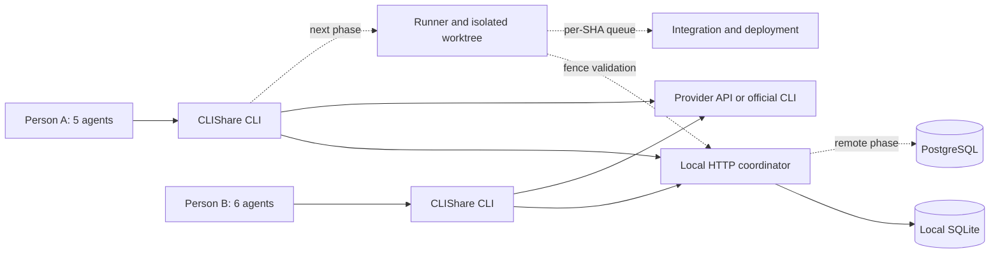

# CLIShare: product and architecture design

Date: 14 October 2026. Repository: `jtpydk5gyh-alt/clishare`. It was created
private; the owner has decided to open it under the OSI MIT license. Their
confirmed development preferences live in `AGENTS.md`.

## 1. Outcome we are after

CLIShare will be a CLI for working with AI on shared projects. Each person
will use their own provider credentials, create a project, invite
collaborators, and coordinate several agents. Shared memory will preserve
decisions and context; a coordinator will reserve resources to reduce
collisions; an isolated runner and an integration queue will enforce those
reservations before any write or deploy.

The main scenario is one owner with five agents and one collaborator with
six. All eleven can query the same context and work on independent tasks.
If two need to modify the same file, directory, or deployment environment,
one waits and replans. A reservation is not permanent permission: it
expires and carries a generation number that allows rejecting stale
processes.

## 2. Initial scope and verifiable limits

The first deliverable is a **local coordination pilot** that runs on one
machine. It includes an HTTP service limited to loopback, users with a
personal bearer, projects, roles, one-use invitations, versioned memory,
leases with expiration, and audit events. The CLI consumes that service
and can query AI through API keys or run the official CLIs that keep
their own login.

The pilot **does not stop an editor or an external process from writing
files**, does not create worktrees automatically, and does not run
deployments. Leases are transactional information shared between
cooperating clients. Effective write protection needs the runner and the
isolation of the next phase. It also does not support secure remote
collaboration: two machines must not share the SQLite file or publish
this server on the internet.

The full roadmap keeps these differences. A milestone is only considered
done when it passes its acceptance tests; describing a milestone does not
mean it is implemented.

## 3. Alternatives and decision

| Approach | Advantages | Cost and limits | Decision |
| --- | --- | --- | --- |
| Memory and lock files in Git | Very easy to inspect; no service | Does not solve simultaneous acquisition, reliable expiration, or permissions; pull and push is not a mutex | Rejected for coordination |
| Local coordinator with SQLite and HTTP protocol | Zero runtime dependencies; transactions; reproducible tests; works on Windows, macOS, and Linux | Single-machine pilot; writes remain cooperative | First delivery |
| HTTPS service with PostgreSQL and isolated runners | Cross-machine collaboration; centralised permissions; scaling and recovery | More operations, authentication, deployment, and security surface | Product goal after validating the protocol |

We pick Python to ship a small CLI and a coordinator using only the
standard library. The versioned protocol avoids coupling the client to
SQLite. For the remote service, PostgreSQL provides transactions and
locking mechanisms, but we will also need to design conflicts by prefix
in addition to row locking: a lock on `src/` and one on `src/api.py` are
not the same row. Reference: [PostgreSQL explicit locking](https://www.postgresql.org/docs/current/explicit-locking.html).

## 4. Global constraints

- Python >= 3.11.
- Zero third-party runtime dependencies in the pilot.
- SQLite with WAL for local persistence; the database file stays on local disk.
- Pilot HTTP is loopback-only; all project routes require a bearer.
- Maximum HTTP body of 1 MiB.
- Default lease TTL of 120 seconds, range 1 to 3600 seconds.
- Default invitation TTL of 3600 seconds, range 1 to 604800 seconds.
- Only the owner can issue invitations or acquire `deploy:environment` leases.
- AI credentials belong to each user and never enter shared memory.
- A provider's native OAuth is not enabled without an official mechanism and verified eligibility.
- Guarantees about files and deployments are only announced when the runner and the corresponding integration make them hold.

## 5. Components and responsibilities

| Unit | Responsibility | Data it must never receive |
| --- | --- | --- |
| CLI and HTTP client | Local configuration, commands, readable errors, authenticated sending | Another collaborator's credentials |
| Store | Identities, permissions, CAS memory, leases, and transactional audit | Provider API keys |
| Server | Validate HTTP and JSON, authenticate, apply limits, and translate errors | Provider tokens by default |
| AI adapters | Translate one query into an API call or an official CLI | Coordination bearer in prompts |
| Future runner | Its own worktree, tool permissions, fences, heartbeat, and patch | Production deploy credentials |
| Future integrator | Verify base SHA, tests, and merge queue | Prompts that could execute instructions |
| Future deployer | Immutable artefact, environment, state, idempotence, and rollback | General ability to edit code |

## 6. Identity, members, and invitations

The pilot creates users through `POST /v1/users` on loopback. It returns a
personal token once and stores only its hash. Proven identity is the
possession of the token; the name is a label and does not verify a GitHub
account or an email address. Open local registration is not an identity
system fit for the internet.

Creating a project makes the creator the `owner`. An invitation grants
`member` or `viewer`, holds a random secret, expires, and can be consumed
only once. Acceptance and membership creation happen in a single
transaction. The API does not allow promoting anyone to `owner` through an
invitation.

| Operation | owner | member | viewer | Non-member |
| --- | --- | --- | --- | --- |
| View project, memory, leases, and events | Yes | Yes | Yes | No |
| Write memory | Yes | Yes | No | No |
| Acquire file leases | Yes | Yes | No | No |
| Renew or release own lease | Yes | Yes | No | No |
| Create invitation | Yes | No | No | No |
| Acquire deployment lease | Yes | No | No | No |

The remote service will add verified accounts, revocable sessions,
agents with their own identity, member administration, and recovery.
CLIShare invitations do not automatically add collaborators to the
private GitHub repository: both permissions are managed separately.

## 7. Data model

The names below express the logical model; migrations will fix SQL names
and indexes.

| Entity | Fields and keys | Core rule |
| --- | --- | --- |
| User | id, name, name_key, token_hash | The token without hash is only delivered at creation |
| Project | id, name, owner_id | The creator gets the owner membership; the date is recorded in its event |
| Membership | project_id + user_id, role | One membership per user and project |
| Invitation | token_hash, project_id, role, expires_at, used_by | Atomic and one-use acceptance; creation is attributed through an event |
| Memory | project_id + key, content, version, author_id, updated_at | Updates compare the expected version |
| Lease | id, project_id, user_id, agent_id, resource, fence, expires_at | One row per resource; all batch resources are acquired or none |
| Fence sequence | Persistent SQLite AUTOINCREMENT, global to the database | The number grows and is not recycled after expiration |
| Event | id, project_id, user_id, kind, data, created_at | Log of accepted changes without secrets |

The future memory will add revision history and links to tasks or commits.
The pilot's audit lets you understand changes but is not a substitute for
a backup or a full history of prior content.

## 8. Shared memory and version control

Entries use keys like `architecture`, `decisions/provider-auth`, or
`handoff/task-42`. `PUT /memory` receives `expected_version`: `0` creates
a missing entry; an update must present the current version. A successful
operation increments the version. If two agents read version 3 and write
at the same time, only one gets 4; the other receives `409` and must
re-read, reconcile, or write a new key. An overwrite is not retried
automatically.

`GET /memory` returns `{items, next_cursor}` with pages of up to ten
entries, `limit=1..10` query, and exclusive `after=KEY` cursor, ordered
by key. Each content holds up to 256 KiB UTF-8. This avoids truncating a
large list in transit; the client caps responses at 32 MiB and returns an
explicit error if that is exceeded. The paginated listing does not
promise a snapshot in the face of concurrent writes.

Memory content is treated as collaborator data, even if it looks like an
instruction. The future runner will separate owner rules, task
instructions, and retrieved content; neither a memory entry nor a model
response can grant permissions, copy secrets, or authorise a deploy.

## 9. Leases, resources, and fences

The coordinator runs acquisition, conflict check, fence assignment, and
event logging inside one write transaction. For SQLite the decision is
serialised by an immediate transaction; WAL helps simultaneous readers
but does not turn SQLite into a distributed database.

- `file:src/api.py` reserves a project-relative path.
- `file:src` reserves that directory prefix and all its descendants.
- Paths use `/`; `\` and ambiguous forms are rejected. Comparison uses a conservative `casefold()` to avoid divergence between Windows and Linux.
- `file:src` conflicts with `file:src/api.py`; `file:src-old/api.py` does not belong to the same prefix.
- Absolute paths, `..` segments, empty paths, and unknown namespaces are rejected.
- `deploy:staging` and `deploy:production` are distinct resources and only the owner can acquire them.
- A batch of three resources is granted in full or nothing changes.
- There are no implicit re-entrant locks: even two requests from the same agent can conflict; it must hold and renew its lease.
- Renewal requires the user that owns the lease and the exact fence; an expired lease does not revive.
- A release with a stale fence is rejected. The next acquisition receives a higher fence even if the prior one has expired.

The fence prevents a consumer that checks it from accepting a stale
writer. By itself it does not stop a process that keeps filesystem
access. The future runner will check ownership, expiration, and fence
immediately before each write and before applying a patch to the
integration checkout.

## 10. Sequence for the eleven-agent case

1. Person A creates `acme`, keeps their local token, and issues a member invitation for B.
2. B creates their local identity and consumes the invitation. Both read the same project memory and members.
3. A assigns A1–A5 and B assigns B1–B6. `agent_id` identifies each run; in the pilot it is a label under the user's identity, not an autonomous credential.
4. A1 asks for `file:src/api.py`; B1 asks for `file:src`. The coordinator grants only one of those requests and returns `409` to the other.
5. A2 and B2 reserve disjoint paths and continue. The rest can plan or query memory without reserving the whole project.
6. Each agent writes decisions with their expected version. Memory conflicts are resolved by reading the new revision.
7. In the pilot each client renews or releases explicitly. When one dies, the lease stops blocking after the TTL.
8. In the runner phase, a heartbeat every 30 seconds renews 120-second leases. If it fails, the runner stops writing and marks the task as interrupted.
9. In the integration phase, each agent delivers a patch or commit against a registered base SHA; it is validated, tested, and queued for merge.
10. In the deploy phase, the owner promotes a concrete SHA and artefact to staging or production. The queue is serialised per project and environment, the generation is recorded, and health is verified.
11. If a deploy fails, the attempt result is kept and rollback is proposed or executed per the environment policy; another mutable `HEAD` is not deployed automatically.

## 11. AI access

CLIShare has two independent authentications: the coordination token and
the provider credentials. Sharing a project shares context and work, not a
subscription or an API key.

| Provider | User API key | Account or subscription in the pilot | Future native integration |
| --- | --- | --- | --- |
| OpenAI | `OPENAI_API_KEY` env var, provider billing | Run the official Codex with its local session | Evaluate Sign in with ChatGPT and eligible client registration |
| Anthropic | `ANTHROPIC_API_KEY` env var, provider billing | Run the official Claude Code unmodified; log in through its CLI | Do not collect or broker Claude.ai OAuth |
| Google | `GEMINI_API_KEY` env var, project and quota requirements by modality | Log in through the official Gemini CLI; CLI chat is blocked until a verified no-tool mode is available | Only documented and authorised authentication mechanisms |

OpenAI documents a native [Sign in with ChatGPT registration and sign-in](https://developers.openai.com/siwc/token-sharing-open-source/sign-in)
mechanism whose access and modality must be verified. A private repository
does not prove eligibility. The native phase will have activation
criteria and will verify the [preview limitations](https://developers.openai.com/siwc/token-sharing-open-source/preview-limitations),
including the streaming and storage behaviour that the modality requires.

Claude Code's [legal documentation](https://code.claude.com/docs/en/legal-and-compliance)
distinguishes using its binary from brokering Claude.ai credentials. The
adapter will not extract or copy those credentials. [Gemini CLI documents
its authentication modalities](https://geminicli.com/docs/get-started/authentication/)
and Codex maintains [its official authentication guide](https://learn.chatgpt.com/docs/auth).

The Codex and Claude adapters will query the installed CLI's capabilities
and only run chat with verified flags that limit tools and configuration.
If they are missing, they will return a version error; Gemini CLI will
allow login, but its chat will return `text_mode_unavailable` until that
verified mode is available. The Google API will allow text queries with an
API key.

Providers will return explicit errors for missing credentials, missing
CLI, timeouts, and invalid responses. The user picks the model and
provider. A prompt will not be sent to another provider as a fallback
without an explicit policy, because it changes the data destination and
the cost. CI tests will use mocked responses; a real provider test will
be optional and will consume the runner's account.

## 12. Future runner and integration

Each run will get its own worktree or checkout created from a base SHA, a
dedicated artefact directory, and a budget. Filesystem operations will
resolve real paths, reject escapes, reject symlinks or junctions that
leave the workspace, and reject substitution races between check and
write. Renames, deletions, generated files, and lockfile changes will
also be validated.

The runner will only give the agent mediated read and write tools. A
subprocess with shell or arbitrary write access will only be allowed
inside an isolation layer that does not expose the shared checkout or
secrets. Adding a hook to a CLI with free disk access is not a guarantee
of exclusion.

Tasks will have `queued`, `running`, `blocked`, `review`, `merged`,
`failed`, and `cancelled` states and acyclic dependencies. The merge
queue will revalidate base SHA and resources; a file lease does not
guarantee that two changes in different files are semantically
compatible. Tests will run on the final base and conflicts will be
resolved before integrating.

## 13. Future deploys

A deploy request contains project, environment, commit SHA, artefact
digest, and idempotency key. The API will require permissions and store
`queued → running → healthy/failed/rolled_back`. The worker will use an
environment lease with fence, consume environment-specific credentials,
and reject stale generations. The tested artefact will be deployed with a
verified digest, and the previous version will be kept for rollback.

Production may require owner approval through a persisted policy.
Before turning deploys on, we will define a real destination, its
secrets, the health check, and the rollback operation. The pilot does
not request or store those credentials.

GitHub Actions can reinforce serialisation and environment protections:
[deployment control](https://docs.github.com/en/actions/how-tos/deploy/configure-and-manage-deployments/control-deployments).
We will not assume that `cancel-in-progress: false` creates a durable
FIFO queue: we will verify the modality and the current limits when
implementing, including the [May 2026 queue expansion](https://github.blog/changelog/2026-05-07-github-actions-concurrency-groups-now-allow-larger-queues/).
CLIShare will keep its own deploy log and idempotence.

## 14. Remote service, security, and operations

The remote phase will replace open local registration with verified
accounts and revocable sessions. The deployment will terminate TLS, rate
limit requests, isolate tenants, and use PostgreSQL with migrations,
backups, and restore tests. Each query and mutation will check project
and user; unpredictable IDs are not a substitute for authorisation.
Clocks and expirations come from the coordinator, not from the agent's
declared time.

| Threat or failure | Required response | Pilot limit |
| --- | --- | --- |
| Loss of API key | Local env vars; do not send them to the coordinator or events | The local process and the provider remain trusted |
| Theft of coordination bearer | Hash in DB; avoid logs; revocable sessions on the remote side | The persisted local token needs operating-system permissions |
| Two simultaneous acquisitions | Transaction and per-prefix check | Does not protect external writers |
| Dead agent or dropped network | TTL; fence; runner stops writing if it cannot renew | Manual renewal and no runner |
| Invitation reuse | Hash, expiration, and transactional consumption | Invitation does not verify email identity |
| Reading another project | Authorisation on every endpoint | No isolation between administrators on the same team |
| Malicious prompt in memory | Treat as data; permissions outside the model | The query CLI does not run model tools |
| Coordinator saturation | Body cap; validation; remote limits and queues | No full defence against hostile local clients |
| Remote or corrupt SQLite | Local disk; backups; PostgreSQL migration | Do not deploy on a shared volume between machines |
| Duplicate or stale deploy | SHA and digest, idempotence, and verified fence | Only the `deploy:*` reservation exists |

Future observability will log request ID, project, task, agent,
lease and fence, provider and model, tokens, latency, and result.
Prices will have a query date, unit, and source; unknown data will not
be counted as zero. There will be per user and project limits, a
maximum number of active agents, and a per-task estimate. Eleven
concurrent agents do not imply eleven unlimited requests or shared
consumption of a subscription.

## 15. Milestones and acceptance

| Milestone | Deliverable | Acceptance criterion |
| --- | --- | --- |
| M0: local base | CLI, loopback HTTP, tokens, projects, and invitations | Two identities share a project; the viewer does not mutate; non-members cannot access |
| M1: coordination | CAS memory, leases, fences, and events | Eleven clients racing for one resource leave a single active lease; memory does not silently lose a write |
| M2: AI | API keys and official CLI wrappers | Mocked tests validate payload and errors; secrets are absent from logs and DB |
| M3: isolated writes | Runner, worktrees, heartbeat, and gates | A runner with an expired fence cannot apply changes; escaped paths are rejected |
| M4: remote | HTTPS, PostgreSQL, revocable identity, and remote invitations | Two machines collaborate; restore is proven; tenants are isolated |
| M5: task flow | DAG and merge queue per base SHA | Eleven agents integrate compatible patches or leave conflicts explicit |
| M6: deploy | Artefacts, per-environment queue, health, and rollback | Idempotent duplicate, stale writer rejected, and rollback rehearsed |
| M7: operations | Budgets, traces, and versioned distribution | Budget cuts new runs; clean install and upgrades proven |

The actionable plan lives in
[2026-10-14-clishare.md](../plans/2026-10-14-clishare.md). The initial
network contract lives in [PROTOCOL.md](../../PROTOCOL.md).
