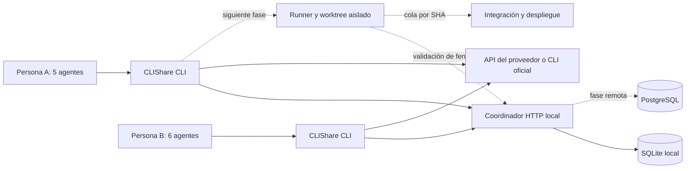

# CLIShare: diseño de producto y arquitectura

Fecha: 14 de octubre de 2026. Repositorio: `jtpydk5gyh-alt/clishare`. Se creó privado; el propietario ha decidido abrirlo bajo MIT de OSI. Sus preferencias de desarrollo confirmadas están en `AGENTS.md`.

## 1. Resultado que buscamos

CLIShare será una CLI para trabajar con IA en proyectos compartidos. Cada persona utilizará sus propias credenciales de proveedor, podrá crear un proyecto e invitar colaboradores y coordinar varios agentes. La memoria compartida conservará decisiones y contexto; un coordinador reservará recursos para reducir colisiones; un runner aislado y una cola de integración harán cumplir esas reservas antes de escribir o desplegar.

El escenario principal es un propietario con cinco agentes y un colaborador con seis. Los once pueden consultar el mismo contexto y trabajar en tareas independientes. Si dos necesitan modificar el mismo archivo, directorio o entorno de despliegue, uno espera y vuelve a planificar. Una reserva no equivale a permiso permanente: caduca y lleva un número de generación que permite rechazar procesos antiguos.

## 2. Alcance inicial y límites verificables

El primer entregable es un **piloto local de coordinación**, ejecutable en una máquina. Incluye un servicio HTTP limitado a loopback, usuarios con bearer personal, proyectos, roles, invitaciones de un uso, memoria con control de versiones, reservas con caducidad y eventos de auditoría. La CLI consumirá ese servicio y permitirá consultar IA mediante API keys o ejecutar CLIs oficiales que conservan su propio inicio de sesión.

El piloto **no impide que un editor o un proceso externo escriba archivos**, no crea worktrees automáticamente y no ejecuta despliegues. Las reservas son información transaccional compartida entre clientes que cooperan. La protección efectiva de escrituras requiere el runner y el aislamiento de la fase siguiente. Tampoco admite colaboración remota segura: dos ordenadores no deben compartir el archivo SQLite ni publicar este servidor en Internet.

La hoja de ruta completa mantiene estas diferencias. Un hito solo se considera terminado cuando cumple sus pruebas de aceptación; describir un hito no significa que esté implementado.

## 3. Alternativas y decisión

| Enfoque | Ventajas | Coste y límites | Decisión |
| --- | --- | --- | --- |
| Archivo de memoria y locks en Git | Muy fácil de inspeccionar; sin servicio | No resuelve adquisición simultánea, caducidad fiable ni permisos; pull/push no es un mutex | Descartado para coordinación |
| Coordinador local con SQLite y protocolo HTTP | Cero dependencias de ejecución; transacciones; pruebas reproducibles; funciona en Windows, macOS y Linux | Piloto de una máquina; las escrituras siguen siendo cooperativas | Primera entrega |
| Servicio HTTPS con PostgreSQL y runners aislados | Colaboración entre máquinas; permisos centralizados; escalado y recuperación | Más operación, autenticación, despliegue y superficie de seguridad | Objetivo de producto tras validar el protocolo |

Se elige Python para distribuir una CLI pequeña y un coordinador con bibliotecas estándar. El protocolo versionado evita acoplar el cliente a SQLite. Para el servicio remoto, PostgreSQL proporciona transacciones y mecanismos de bloqueo, pero será necesario diseñar los conflictos por prefijo además de bloquear filas: un lock de `src/` y otro de `src/api.py` no son la misma fila. Referencia: [bloqueos explícitos de PostgreSQL](https://www.postgresql.org/docs/current/explicit-locking.html).

## 4. Restricciones globales

- Python >=3.11.
- Cero dependencias runtime de terceros en el piloto.
- SQLite con WAL para persistencia local; el archivo de base de datos permanece en disco local.
- HTTP del piloto limitado a loopback; todas las rutas de proyecto requieren bearer.
- Cuerpo HTTP máximo de 1 MiB.
- TTL de reservas por defecto de 120 segundos, rango de 1 a 3600 segundos.
- TTL de invitaciones por defecto de 3600 segundos, rango de 1 a 604800 segundos.
- Solo el propietario puede emitir invitaciones o adquirir reservas `deploy:entorno`.
- Las credenciales de IA pertenecen a cada usuario y nunca forman parte de la memoria compartida.
- No se habilitará OAuth propio de un proveedor sin un mecanismo oficial y elegibilidad comprobada.
- Las garantías sobre archivos y despliegues solo se anunciarán cuando el runner y la integración correspondiente las hagan cumplir.

## 5. Componentes y responsabilidades

| Unidad | Responsabilidad | Datos que nunca debe recibir |
| --- | --- | --- |
| CLI y cliente HTTP | Configuración local, comandos, errores legibles, envío autenticado | Credenciales de otro colaborador |
| Store | Identidades, permisos, memoria CAS, reservas y auditoría transaccional | API keys de los proveedores |
| Servidor | Validar HTTP/JSON, autenticar, aplicar límites y traducir errores | Tokens del proveedor por defecto |
| Adaptadores de IA | Traducir una consulta a API o CLI oficial | Bearer de coordinación en prompts |
| Runner futuro | Worktree propio, permisos de herramientas, fences, heartbeat y patch | Credenciales de despliegue de producción |
| Integrador futuro | Verificar base SHA, pruebas y cola de merge | Prompts que puedan ejecutar instrucciones |
| Desplegador futuro | Artefacto inmutable, entorno, estado, idempotencia y rollback | Capacidad general de editar código |

## 6. Identidad, miembros e invitaciones

El piloto crea usuarios mediante `POST /v1/users` en loopback. Devuelve un token personal una vez y almacena únicamente su hash. La identidad demostrada es la posesión del token; el nombre es una etiqueta y no verifica una cuenta de GitHub ni una dirección de correo. El alta local abierta no es un sistema de identidad apto para Internet.

Crear un proyecto incorpora al creador como `owner`. Una invitación concede `member` o `viewer`, contiene un secreto aleatorio, caduca y solo se puede consumir una vez. Su aceptación y el alta de membresía ocurren en una transacción. La API no permite elevar a alguien a `owner` mediante una invitación.

| Operación | owner | member | viewer | No miembro |
| --- | --- | --- | --- | --- |
| Ver proyecto, memoria, reservas y eventos | Sí | Sí | Sí | No |
| Escribir memoria | Sí | Sí | No | No |
| Adquirir reserva de archivos | Sí | Sí | No | No |
| Renovar o liberar reserva propia | Sí | Sí | No | No |
| Crear invitación | Sí | No | No | No |
| Adquirir reserva de despliegue | Sí | No | No | No |

El servicio remoto añadirá cuentas verificadas, sesiones revocables, agentes con identidad propia, administración de miembros y recuperación. Las invitaciones de CLIShare no añaden automáticamente colaboradores al repositorio privado de GitHub: ambos permisos se gestionan por separado.

## 7. Modelo de datos

Los nombres siguientes expresan el modelo lógico; las migraciones fijarán nombres SQL e índices.

| Entidad | Campos y claves | Regla esencial |
| --- | --- | --- |
| Usuario | id, name, name_key, token_hash | El token sin hash solo se entrega al crearlo |
| Proyecto | id, name, owner_id | El creador recibe membresía owner; la fecha consta en su evento |
| Membresía | project_id + user_id, role | Una membresía por usuario y proyecto |
| Invitación | token_hash, project_id, role, expires_at, used_by | Aceptación atómica y de un solo uso; la creación se atribuye mediante evento |
| Memoria | project_id + key, content, version, author_id, updated_at | La actualización compara la versión esperada |
| Reserva | id, project_id, user_id, agent_id, resource, fence, expires_at | Una fila por recurso; todos los recursos del lote se adquieren o ninguno |
| Secuencia de fences | AUTOINCREMENT persistente de SQLite, global a la BD | El número aumenta y no se recicla tras caducar |
| Evento | id, project_id, user_id, kind, data, created_at | Registro de cambios aceptados sin secretos |

La futura memoria añadirá historial de revisiones y relación con tarea/commit. La auditoría del piloto permite entender cambios, pero no sustituye una copia de seguridad ni un historial completo del contenido anterior.

## 8. Memoria compartida y control de versiones

Las entradas usan claves como `architecture`, `decisions/provider-auth` o `handoff/task-42`. `PUT /memory` recibe `expected_version`: `0` crea una entrada inexistente; una actualización debe presentar la versión actual. Una operación exitosa aumenta la versión. Si dos agentes leen la versión 3 y escriben a la vez, solo uno obtiene la 4; el otro recibe `409` y debe releer, reconciliar o escribir una nueva clave. No se reintenta una sobrescritura automáticamente.

`GET /memory` devuelve `{items, next_cursor}` con páginas de hasta diez entradas, query `limit=1..10` y cursor exclusivo `after=KEY`, ordenado por clave. Cada contenido admite hasta 256 KiB UTF-8. Así se evita truncar una lista grande al transportarla; el cliente limita respuestas a 32 MiB y devuelve un error explícito si se supera. El listado paginado no promete un snapshot frente a escrituras concurrentes.

El contenido de la memoria se trata como datos de colaboradores, incluso si parece una instrucción. El futuro runner separará reglas del propietario, instrucciones de tarea y contenido recuperado; ni una entrada de memoria ni una respuesta de modelo podrá conceder permisos, copiar secretos o autorizar un despliegue.

## 9. Reservas, recursos y fences

El coordinador realiza adquisición, verificación de conflictos, asignación de fence y evento dentro de una transacción de escritura. Para SQLite se serializa la decisión mediante una transacción inmediata; WAL facilita lectores simultáneos, pero no convierte SQLite en una base distribuida.

- `file:src/api.py` reserva una ruta relativa al proyecto.
- `file:src` reserva ese prefijo de directorio y todos sus descendientes.
- Las rutas usan `/`; se rechazan `\` y formas ambiguas. Se comparan con `casefold()` de forma conservadora para evitar divergencias entre Windows y Linux.
- `file:src` entra en conflicto con `file:src/api.py`; `file:src-old/api.py` no pertenece al mismo prefijo.
- Se rechazan rutas absolutas, segmentos `..`, rutas vacías y namespaces desconocidos.
- `deploy:staging` y `deploy:production` son recursos distintos y solo puede adquirirlos el propietario.
- Un lote con tres recursos se concede completo o no cambia nada.
- No hay locks reentrantes implícitos: incluso dos solicitudes del mismo agente pueden entrar en conflicto; debe conservar y renovar su reserva.
- La renovación requiere usuario propietario de la reserva y fence exacto; un lease caducado no revive.
- Una liberación con fence antiguo se rechaza. La siguiente adquisición recibe un fence mayor aunque la anterior haya caducado.

El fence evita que un consumidor que lo comprueba acepte un escritor antiguo. Por sí solo no detiene un proceso que conserva acceso al sistema de archivos. El runner futuro comprobará pertenencia, expiración y fence inmediatamente antes de cada escritura y antes de aplicar un patch al checkout de integración.

## 10. Secuencia del caso de once agentes

1. La persona A crea `acme`, conserva su token local y genera una invitación de miembro para B.
2. B crea su identidad local y consume la invitación. Ambos leen la misma memoria y miembros del proyecto.
3. A asigna A1–A5 y B asigna B1–B6. `agent_id` identifica cada ejecución; en el piloto es una etiqueta bajo la identidad del usuario, no una credencial autónoma.
4. A1 pide `file:src/api.py`; B1 pide `file:src`. El coordinador solo concede una de esas peticiones y devuelve `409` a la otra.
5. A2 y B2 reservan rutas disjuntas y continúan. Los demás pueden planificar o consultar memoria sin reservar todo el proyecto.
6. Cada agente escribe decisiones con su versión esperada. Los conflictos de memoria se resuelven leyendo la revisión nueva.
7. En el piloto, cada cliente renueva o libera explícitamente. Al morir uno, la reserva deja de bloquear después del TTL.
8. En la fase runner, un heartbeat cada 30 segundos renueva leases de 120 segundos. Si falla, el runner detiene las escrituras y marca la tarea como interrumpida.
9. En la fase integración, cada agente entrega un patch/commit contra una base SHA registrada; se valida, prueba e integra en cola.
10. En la fase despliegue, el propietario promueve un SHA/artefacto concreto a staging o producción. La cola serializa por proyecto y entorno, registra la generación y verifica salud.
11. Si falla el despliegue, se conserva el resultado del intento y se propone o ejecuta el rollback según la política del entorno; no se despliega automáticamente otro `HEAD` mutable.

## 11. Acceso a IA

CLIShare tiene dos autenticaciones independientes: el token de coordinación y las credenciales del proveedor. Compartir un proyecto comparte contexto y trabajo, no una suscripción ni una API key.

| Proveedor | API key del usuario | Cuenta/suscripción en el piloto | Integración propia futura |
| --- | --- | --- | --- |
| OpenAI | Variable `OPENAI_API_KEY`, facturación del proveedor | Ejecutar Codex oficial con su sesión local | Evaluar Sign in with ChatGPT y registro de cliente elegible |
| Anthropic | Variable `ANTHROPIC_API_KEY`, facturación del proveedor | Ejecutar Claude Code oficial sin modificar; login en su CLI | No recopilar ni intermediar OAuth de Claude.ai |
| Google | Variable `GEMINI_API_KEY`, requisitos de proyecto/cuota según modalidad | Login mediante Gemini CLI oficial; chat de CLI bloqueado hasta disponer de un modo sin herramientas verificado | Solo mecanismos de autenticación documentados y autorizados |

OpenAI documenta un mecanismo propio de [registro e inicio de sesión de Sign in with ChatGPT](https://developers.openai.com/siwc/token-sharing-open-source/sign-in), cuyo acceso y modalidad deben comprobarse. Un repositorio privado no demuestra elegibilidad. La fase propia tendrá criterios de activación y verificará las [limitaciones de la vista previa](https://developers.openai.com/siwc/token-sharing-open-source/preview-limitations), incluido el comportamiento de streaming y almacenamiento que exija la modalidad.

La [documentación legal de Claude Code](https://code.claude.com/docs/en/legal-and-compliance) distingue el uso de su binario de la intermediación de credenciales de Claude.ai. El adaptador no extraerá ni copiará esas credenciales. [Gemini CLI documenta sus modalidades de autenticación](https://geminicli.com/docs/get-started/authentication/) y Codex mantiene [su guía oficial de autenticación](https://learn.chatgpt.com/docs/auth).

Los adaptadores de Codex y Claude consultarán capacidades de la CLI instalada y solo ejecutarán chat con flags comprobados que limiten herramientas y configuración. Si faltan, devolverán un error de versión; Gemini CLI permitirá login, pero su chat devolverá `text_mode_unavailable` mientras no exista ese modo verificado. La API de Google sí permitirá consultas de texto mediante API key.

Los proveedores devolverán errores explícitos para credencial ausente, CLI no instalada, tiempo agotado y respuesta inválida. El usuario elige modelo y proveedor. No se enviará un prompt a otro proveedor como fallback sin una política explícita, porque cambia destino de datos y coste. Las pruebas de CI usarán respuestas simuladas; una prueba real de proveedor será optativa y consumirá la cuenta de quien la ejecute.

## 12. Runner e integración futuros

Cada ejecución dispondrá de un worktree/checkout propio creado desde una base SHA, un directorio de artefactos y un presupuesto. Las operaciones de filesystem resolverán rutas reales, rechazarán escapes, symlinks/junctions que salgan del workspace y condiciones de sustitución entre validación y escritura. Se validarán también renames, borrados, archivos generados y cambios en lockfiles.

El runner solo dará al agente herramientas de lectura y escritura mediadas. Un subprocess con shell o escritura arbitraria solo se admitirá dentro de un aislamiento que no exponga el checkout compartido ni secretos. Añadir un hook a una CLI con acceso libre al disco no constituye una garantía de exclusión.

Las tareas tendrán estados `queued`, `running`, `blocked`, `review`, `merged`, `failed`, `cancelled` y dependencias acíclicas. La cola de merge revalidará base SHA y recursos; una reserva de archivo no garantiza que dos cambios de archivos distintos sean semánticamente compatibles. Se ejecutarán pruebas en la base final y se resolverán conflictos antes de integrar.

## 13. Despliegues futuros

Una solicitud de despliegue contiene proyecto, entorno, commit SHA, digest del artefacto e idempotency key. La API exigirá permisos y guardará `queued → running → healthy/failed/rolled_back`. El worker utilizará una reserva de entorno con fence, consumirá credenciales específicas del entorno y rechazará generaciones antiguas. Se desplegará el artefacto probado, con digest verificado, y se conservará la versión anterior para rollback.

Producción podrá exigir aprobación del propietario mediante una política persistida. Antes de activar despliegues se definirá un destino real, sus secretos, la prueba de salud y la operación de rollback. El piloto no solicita ni almacena esas credenciales.

GitHub Actions puede reforzar la serialización y las protecciones del entorno: [control de despliegues](https://docs.github.com/en/actions/how-tos/deploy/configure-and-manage-deployments/control-deployments). No se asumirá que `cancel-in-progress: false` crea una cola FIFO duradera: se verificará la modalidad y los límites vigentes al implementar, incluida la [ampliación de colas anunciada en mayo de 2026](https://github.blog/changelog/2026-05-07-github-actions-concurrency-groups-now-allow-larger-queues/). CLIShare mantendrá su propio registro de despliegues e idempotencia.

## 14. Servicio remoto, seguridad y operación

La fase remota reemplazará el alta local por cuentas verificadas y sesiones revocables. El despliegue terminará TLS, limitará peticiones, separará tenants y usará PostgreSQL con migraciones, backups y pruebas de restauración. Cada consulta y mutación comprobará proyecto y usuario; los IDs impredecibles no sustituyen autorización. Los relojes y la expiración procederán del coordinador, no de la hora declarada por el agente.

| Amenaza o fallo | Respuesta requerida | Límite del piloto |
| --- | --- | --- |
| Pérdida de API key | Variables locales; no enviarlas al coordinador ni eventos | El proceso local y el proveedor siguen siendo de confianza |
| Robo de bearer de coordinación | Hash en BD; evitar logs; sesiones revocables en remoto | Token local persistido requiere permisos del sistema operativo |
| Dos adquisiciones simultáneas | Transacción y comprobación por prefijo | No protege escritores externos |
| Agente muerto o red caída | TTL; fence; runner detiene escrituras si no renueva | Renovación manual y sin runner |
| Reutilización de invitación | Hash, expiración y consumo transaccional | Invitación no verifica identidad de correo |
| Lectura de otro proyecto | Autorización en cada endpoint | Sin aislamiento entre administradores del mismo equipo |
| Prompt malicioso en memoria | Tratarlo como datos; permisos fuera del modelo | La CLI de consulta no ejecuta herramientas del modelo |
| Saturación del coordinador | Cuerpo máximo; validación; límites/colas remotas | Sin defensa integral frente a clientes locales hostiles |
| SQLite remoto o corrupto | Disco local; backups; migración PostgreSQL | No desplegar en volumen compartido entre máquinas |
| Despliegue duplicado o obsoleto | SHA/digest, idempotencia y fence verificado | Solo existe la reserva `deploy:*` |

La observabilidad futura registrará request ID, proyecto, tarea, agente, lease/fence, proveedor/modelo, tokens, latencia y resultado. Los precios tendrán fecha de consulta, unidad y fuente; un dato desconocido no se contabilizará como cero. Habrá límites por usuario/proyecto, máximo de agentes activos y una estimación previa por tarea. Once agentes concurrentes no implican once solicitudes ilimitadas ni consumo compartido de una suscripción.

## 15. Hitos y aceptación

| Hito | Entregable | Criterio de aceptación |
| --- | --- | --- |
| M0: base local | CLI, HTTP loopback, tokens, proyectos e invitaciones | Dos identidades comparten un proyecto; viewer no muta; no miembro no accede |
| M1: coordinación | Memoria CAS, leases, fences, eventos | Once clientes en carrera por un recurso dejan un único lease activo; memoria no pierde una escritura silenciosamente |
| M2: IA | API keys y wrappers de CLI oficial | Pruebas simuladas validan payload y errores; secretos ausentes de logs/BD |
| M3: escritura aislada | Runner, worktrees, heartbeat y gates | Un runner con fence caducado no puede aplicar cambios; rutas escapadas se rechazan |
| M4: remoto | HTTPS, PostgreSQL, identidad revocable e invitaciones remotas | Dos máquinas colaboran; restauración probada; aislamiento entre tenants |
| M5: flujo de tareas | DAG y cola de merge por base SHA | Once agentes integran patches compatibles o dejan conflictos explícitos |
| M6: despliegue | Artefactos, cola por entorno, salud y rollback | Duplicado idempotente, escritor obsoleto rechazado y rollback ensayado |
| M7: operación | Presupuestos, trazas y distribución versionada | Presupuesto corta nuevas ejecuciones; instalación limpia y upgrades probados |

El plan accionable está en [2026-10-14-clishare.md](../plans/2026-10-14-clishare.md). El contrato inicial de red está en [PROTOCOL.md](../../PROTOCOL.md).
